# Báo cáo dự án: Trích xuất câu trả lời tiếng Việt (Extractive QA) trên UIT-ViQuAD 2.0

Mô hình so sánh: PhoBERT-base-v2, XLM-R base, XLM-R large (nhóm A, tự fine-tune); `vi-mrc-base` / `vi-mrc-large` (nhóm B, chỉ để tham chiếu).

## Mục lục

1. [Tóm tắt](#1-tóm-tắt)
2. [Bối cảnh, giao thức và nguyên tắc thí nghiệm](#2-bối-cảnh-giao-thức-và-nguyên-tắc-thí-nghiệm)
3. [Bước 0: Môi trường](#3-bước-0-môi-trường)
4. [Bước 1: Dữ liệu (EDA, làm sạch, chia tập)](#4-bước-1-dữ-liệu-eda-làm-sạch-chia-tập)
5. [Bước 2: Baseline zero-shot (vi-mrc, thực hiện muộn)](#5-bước-2-baseline-zero-shot-vi-mrc-thực-hiện-muộn)
6. [Bước 3: Tiền xử lý để huấn luyện (cửa sổ trượt, gán nhãn)](#6-bước-3-tiền-xử-lý-để-huấn-luyện-cửa-sổ-trượt-gán-nhãn)
7. [Bước 4: Hậu xử lý và metric](#7-bước-4-hậu-xử-lý-và-metric)
8. [Tokenizer: XLM-R SentencePiece so với PhoBERT BPE trên văn bản đã tách từ](#8-tokenizer-xlm-r-sentencepiece-so-với-phobert-bpe-trên-văn-bản-đã-tách-từ)
9. [Bước 5: Fine-tune XLM-R (base, large)](#9-bước-5-fine-tune-xlm-r-base-large)
10. [Bước 6: Fine-tune PhoBERT (tách từ, sửa tokenizer, phân kỳ)](#10-bước-6-fine-tune-phobert-tách-từ-sửa-tokenizer-phân-kỳ)
11. [Chương trình cải thiện công bằng (giai đoạn 1-4)](#11-chương-trình-cải-thiện-công-bằng-giai-đoạn-1-4)
12. [Bước 7: Đánh giá trên test, so sánh và phân tích lỗi](#12-bước-7-đánh-giá-trên-test-so-sánh-và-phân-tích-lỗi)
13. [Đánh giá dataset và mô hình](#13-đánh-giá-dataset-và-mô-hình)
14. [Bước 8: API `answer()` và demo CLI](#14-bước-8-api-answer-và-demo-cli)
    - [14b. Model phát hành (huấn luyện lại có lưu trọng số)](#14b-model-phát-hành-huấn-luyện-lại-có-lưu-trọng-số)
15. [Nhật ký quyết định](#15-nhật-ký-quyết-định)
16. [Sự cố đã gặp và hệ quả](#16-sự-cố-đã-gặp-và-hệ-quả)
17. [Kết luận](#17-kết-luận)
18. [Hệ quả và hạn chế](#18-hệ-quả-và-hạn-chế)
19. [Thành quả](#19-thành-quả)
20. [Công việc tiếp theo](#20-công-việc-tiếp-theo)
21. [Phụ lục: nguồn số liệu, điểm không khớp và những gì chưa kiểm chứng](#21-phụ-lục-nguồn-số-liệu-điểm-không-khớp-và-những-gì-chưa-kiểm-chứng)
22. [Phụ lục: Đối chiếu số liệu](#22-phụ-lục-đối-chiếu-số-liệu)

---

## 1. Tóm tắt

**Bài toán.** Cho câu hỏi tiếng Việt và một đoạn ngữ cảnh, mô hình trả về một đoạn trích trong ngữ cảnh, hoặc trả về rỗng nếu không có đáp án (kiểu SQuAD 2.0). Dữ liệu là UIT-ViQuAD 2.0, trong đó 32,39% câu hỏi ở tập train gốc không có đáp án.

**Giao thức.** Chỉ dùng phần train gốc của UIT-ViQuAD (kể cả `plausible_answers`) để huấn luyện nhóm A. Train gốc được chia theo `title` thành train' 25.542 / dev 2.912. Test là tập validation gốc đã làm sạch (3.814 mẫu), chấm một lần ở cuối với ngưỡng "không có đáp án" tuned trên dev.

**Kết quả test (ensemble 3 seed của cùng một công thức, F1 với khoảng tin cậy bootstrap 95%).**

| Mô hình | Nhóm | F1 | EM |
|---|---|---|---|
| xlmr_base | A | 62.40 [60.89, 63.78] | 53.99 |
| phobert (base-v2) | A | 68.97 [67.63, 70.33] | 59.49 |
| xlmr_large | A | 77.89 [76.68, 79.15] | 68.35 |
| vi_mrc_base (tham chiếu) | B | 64.72 [63.25, 66.18] | 57.26 |
| vi_mrc_large (tham chiếu) | B | 80.48 [79.33, 81.63] | 68.90 |

Nguồn: `notebooks/05_compare_models.ipynb`, cell 19 (bảng CI test); chi tiết ở mục 12.1.

**Các điểm chính.**

- Trong nhóm A, thứ tự là `xlmr_large` > `phobert` > `xlmr_base`, cả ba khác biệt đều có khoảng tin cậy ghép cặp không chứa 0 (mục 12).
- Nhóm B không so sánh công bằng được. F1 dev của `vi_mrc_large` là 89.74, test chỉ 80.48 (chênh 9.26 điểm), là dấu hiệu dev đã bị nhiễm (mục 5, 12).
- Các kỹ thuật bổ sung (LLRD, EMA) không giúp. Hàm mất mát "unlikelihood" trên plausible answer (λ=0.3) có vẻ giúp +0.8 F1 ở một seed, nhưng không giữ được khi lặp 3 seed (mục 11). Cùng cấu hình `xlmr_large` và cùng seed 42 chạy hai lần cho 78.16 (giai đoạn 2) và 76.92 (giai đoạn 3), tức nhiễu không tất định khoảng 1,2 F1 ngay trên một seed, lớn hơn "+0.8" đó (mục 11.4).
- Gần một nửa lỗi của `xlmr_large` trên test (48,5%) là quyết định "có/không có đáp án", không phải hiểu sai nội dung (mục 12.4).
- Có hai sự cố kỹ thuật tốn nhiều thời gian: lỗi CUDA device-side assert ở PhoBERT (nguyên nhân là id token vượt bảng embedding) và PhoBERT lr 3e-5 bị phân kỳ (mục 10).
- **Model phát hành (mục 14b).** Công thức đóng băng được huấn luyện lại có lưu trọng số (fp16). Test ensemble release: F1 63.59 / 68.62 / 77.68 (xlmr_base / phobert / xlmr_large) so với bản gốc 62.40 / 68.97 / 77.89; chỉ xlmr_base khác có ý nghĩa (+1,19). Ở release, 2 trong 4 seed PhoBERT phân kỳ (chưa xác định nguyên nhân) nên ensemble PhoBERT chỉ gồm seed 42 và 43. Kết quả báo cáo chính vẫn là bản gốc ở trên.

---

## 2. Bối cảnh, giao thức và nguyên tắc thí nghiệm

### 2.1. Hai nhóm mô hình

| Nhóm | Mô hình | Dữ liệu huấn luyện | Vai trò |
|---|---|---|---|
| A | `xlmr_base`, `phobert`, `xlmr_large` | Chỉ train của UIT-ViQuAD (train' sau khi chia), kể cả `plausible_answers` | So sánh công bằng với nhau |
| B | `vi_mrc_base`, `vi_mrc_large` (nguyenvulebinh) | Dữ liệu ngoài, gồm SQuAD2, mailong25, VLSP-MRC-2021, MLQA (theo ghi chú trong `summary.json`) | Chỉ tham chiếu, không so sánh công bằng |

Nguồn: định nghĩa nhóm do dự án đặt ra (`README.md`); dữ liệu huấn luyện nhóm B lấy từ trường `notes` của `outputs/sweep/zero_shot/vi_mrc_*/vi_mrc_*__zs/summary.json`.

Dữ liệu ngoài chỉ được dùng ở nhóm B (mô hình có sẵn, không do dự án huấn luyện).

### 2.2. Chia tập và quy tắc chấm

- train' = 25.542 mẫu, dev = 2.912 mẫu, chia theo `title` từ train sạch (seed 42).
- test = validation gốc đã làm sạch, 3.814 mẫu, có tới 3 đáp án tham chiếu mỗi câu.
- Split `test` của HF (7.301 mẫu) không có nhãn (cột `answers` rỗng ở mọi dòng), nên không dùng để tính EM/F1.
- Mọi lựa chọn (siêu tham số, biến thể hậu xử lý, ngưỡng) chỉ dựa trên dev. Test chấm một lần ở notebook 05, kết quả được đóng băng; notebook 06 chỉ đọc lại dự đoán để mô tả lỗi và không đổi quyết định nào.

### 2.3. Quy tắc "ngân sách tinh chỉnh bằng nhau"

Mỗi mô hình nhóm A có đúng 4 cấu hình ở giai đoạn 1, 4 cấu hình add-on ở giai đoạn 2 và 3 seed ở giai đoạn 3. Đây là công bằng về ngân sách tìm kiếm, **không** phải tối ưu hoá đầy đủ (lưới nhỏ; xem mục 18).

---

## 3. Bước 0: Môi trường

**Quan sát.**

| Hạng mục | Giá trị | Nguồn |
|---|---|---|
| Colab (huấn luyện) | Python 3.13.16, torch 2.14.1+cu130, transformers 5.22.1, datasets 4.8.5 | notebook 02-04, cell 3 ("Môi trường") |
| GPU Colab dùng cho sweep | NVIDIA A100-SXM4-40GB (bộ nhớ báo 42,4 GB), hỗ trợ bf16 | notebook 02-04, cell 3 |
| Máy local | Windows 11, `.venv`, RTX 4050 Laptop 6 GB (chạy zero-shot vi-mrc, demo) | `summary.json` zero-shot, trường `gpu.name` |
| Tách từ PhoBERT | VnCoreNLP (py_vncorenlp), cần Java và `data/vncorenlp`; chạy ở máy local, dữ liệu đã tách upload lên Colab | notebook 04, cell 4 (mô tả `get_seg_data`), `src/segment.py` |
| Tốc độ tính toán Colab | A100 6,73 đơn vị/giờ (dùng trong ước tính `est_units`) | notebook 02-04, cell 15; kiểm: `est_units` = `wall_s`/3600 × 6,73 |
| Tốc độ tính toán Colab | T4 1,15, L4 1,94 đơn vị/giờ | không có nguồn trong repo (từ trao đổi) |

Nguồn: từng dòng có cột "Nguồn" bên trên; các phiên bản thư viện của các lượt sweep (giai đoạn 1-3) **không** được lưu trong `results.jsonl`/`summary.json`, nên chỉ biết phiên bản của notebook 02-04.

**Quyết định.** Huấn luyện các sweep trên A100 vì tốc độ/đơn vị tính toán tốt hơn: một lượt `xlmr_large` giai đoạn 3 huấn luyện 781 s (13,0 phút), tổng 833 s (13,9 phút) kể cả tải và chấm dev (`outputs/sweep/stage3/xlmr_large/results.jsonl`). Tách từ chạy local để Colab không cần Java (chọn này không có file nguồn, từ trao đổi).

**Chi tiết kỹ thuật cần nhớ.** `transformers` 5 bỏ tham số `warmup_ratio`; `src/train_qa.py` tự chọn `warmup_ratio` hoặc `warmup_steps` (giá trị float < 1) tuỳ phiên bản. Dùng bf16 khi GPU hỗ trợ, ngược lại fp16.

---

## 4. Bước 1: Dữ liệu (EDA, làm sạch, chia tập)

Nguồn: notebook `01_data_eda.ipynb`, `src/data_clean.py`, `src/data_split.py`.

### 4.1. Quan sát: kích thước và cấu trúc

| Split (HF) | Số dòng | Context duy nhất | Title duy nhất | `is_impossible` (%) |
|---|---|---|---|---|
| train | 28.454 | 4.101 | 138 | 32,39 |
| validation | 3.814 | 557 | 19 | 30,44 |
| test (HF) | 7.301 | 1.241 | 48 | 0,00 (không có nhãn) |

Nguồn: `notebooks/01_data_eda.ipynb`, cell 4.

Số đáp án trên mỗi câu hỏi:

| Số đáp án | train | validation | test (HF) |
|---|---|---|---|
| 0 | 9.216 | 1.161 | 7.301 |
| 1 | 19.238 | 1.423 | 0 |
| 2 | 0 | 1.048 | 0 |
| 3 | 0 | 182 | 0 |

Nguồn: `notebooks/01_data_eda.ipynb`, cell 4 (bảng "Số đáp án trên mỗi câu hỏi"); 1.230 dòng / 32,25% từ cell 7.

Train chỉ có 1 đáp án mỗi câu; validation có nhiều đáp án ở 1.230 dòng (32,25%). Vì vậy khi chấm phải lấy max trên các tham chiếu.

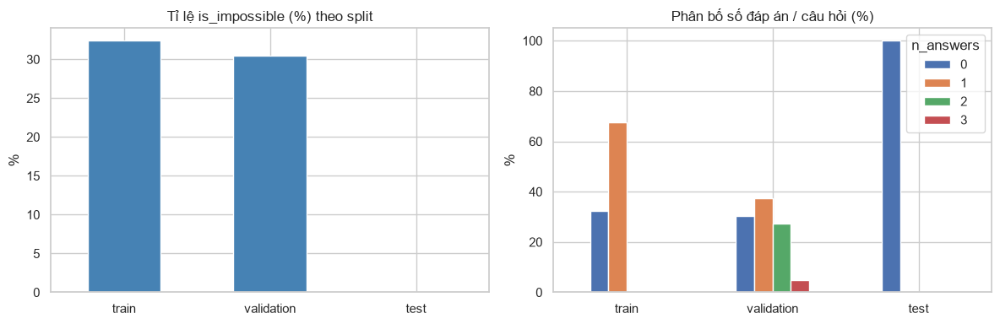

*Hình N1. Trái: % `is_impossible` theo split. Phải: phân bố số đáp án mỗi câu hỏi. Cột test là 0 vì tập test HF chưa có nhãn (trước khi chia lại). Nguồn: notebooks/01_data_eda.ipynb, cell 4.*

### 4.2. Quan sát: audit lỗi trước khi làm sạch

| Lỗi | train | validation | test (HF) |
|---|---|---|---|
| `offset_mismatch` | 154 (0,54%) | 22 (0,58%) | 0 |
| `not_nfc` | 25 (0,09%) | 0 | 0 |
| `has_double_space` | 65 (0,23%) | 5 (0,13%) | 48 (0,66%) |
| `has_nbsp_or_zerowidth` | 10 (0,04%) | 0 | 0 |
| `impossible_with_answer` | 0 | 0 | 0 |

Nguồn: `notebooks/01_data_eda.ipynb`, cell 7 (audit trước khi làm sạch).

Sau khi làm sạch (NFC, bỏ ký tự zero-width, nbsp thành khoảng trắng, gộp khoảng trắng, tính lại `answer_start`), mọi lỗi về 0 trên cả ba split. Số hành động ghi nhận: `offset_fixed` 158 (train) và 22 (validation); `normalized_question` 98 / 7 / 47; `normalized_context` 10 / 0 / 28.

**Chính sách làm sạch.** Train: loại dòng nhãn hỏng. Validation/test: không bao giờ loại dòng, để tập đánh giá còn nguyên. **Kết quả: loại 0 dòng ở cả ba split.** Hệ quả: không có "trần metric do nhãn hỏng" ở validation.

Nguồn các số trong đoạn trên: audit sau làm sạch ở cell 19, bảng số hành động và số dòng loại ở cell 16 của `notebooks/01_data_eda.ipynb`.

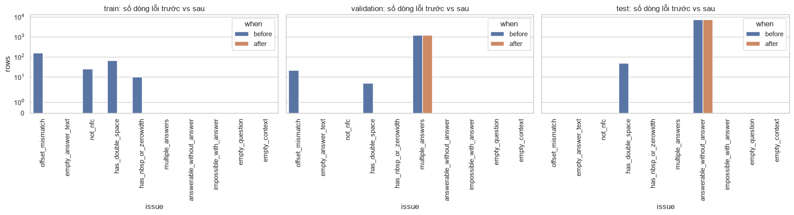

*Hình N2. Số dòng theo từng loại lỗi (thang log) trước và sau khi làm sạch, theo split. Nguồn: notebooks/01_data_eda.ipynb, cell 20.*

### 4.3. Quan sát: độ dài (tokenizer `xlm-roberta-base`, train)

| Thống kê | Context (token) | Câu hỏi (token) | Đáp án (từ) |
|---|---|---|---|
| Trung vị | 192 | 16 | 6 |
| p95 | 374 | 27 | 31 |
| p99 | 474 | 33 | 48 |
| Max | 2.091 | 66 | 150 |

Nguồn: `notebooks/01_data_eda.ipynb`, cell 12 (bảng `describe`; cột câu hỏi lấy trên 28.454 câu, đáp án trên 19.238 câu HasAns).

| `max_length` | Cặp vượt giới hạn | Số window/cặp (TB) | Max window | Tổng window train (ước lượng) |
|---|---|---|---|---|
| 256 | 30,95% | 1,420 | 22 | 40.396 |
| 384 | 6,14% | 1,068 | 9 | 30.399 |

Nguồn: `notebooks/01_data_eda.ipynb`, cell 13.

Nếu chỉ cắt (truncate) ở 384, 0,98% đáp án HasAns bị mất (mẫu 5.000 dòng; cell 13).

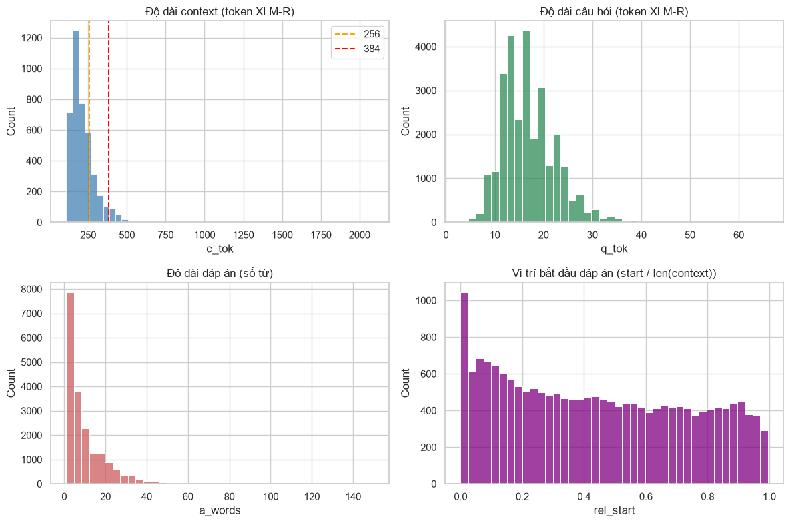

*Hình N3. Histogram độ dài context (token XLM-R, có vạch 256/384), câu hỏi, đáp án (từ) và vị trí tương đối của đáp án, trước khi làm sạch. Nguồn: notebooks/01_data_eda.ipynb, cell 12.*

**Quyết định (Bước 1 → Bước 3).** `max_length` = 384 cho XLM-R, 256 cho PhoBERT (PhoBERT chỉ có 258 vị trí); `doc_stride` = 128; dùng cửa sổ trượt thay vì cắt.

### 4.4. Quan sát: phân tích thêm và kiểm tra rò rỉ

Nguồn các số trong mục này: `notebooks/01_data_eda.ipynb`, cell 23 (cụm đầu câu), cell 24 (NoAns/plausible, độ dài), cell 25 (rò rỉ context).

- Câu hỏi đa dạng: 10 cụm hai từ đầu câu hay gặp nhất chỉ chiếm 12,8% câu hỏi train.
- Câu NoAns trong train có 9.216 dòng, 9.215 dòng (99,99%) có 1 plausible answer. Độ dài trung vị của đáp án HasAns và plausible answer đều 6 từ.
- Độ dài câu hỏi/ngữ cảnh của HasAns và NoAns gần như bằng nhau (câu hỏi trung bình 14,61 so với 14,72 từ), tức độ dài không giúp phân biệt.
- Rò rỉ context: validation dùng chung **0/557** context với train. Split test của HF dùng chung 454/1.241 context với train (29,35% dòng). Validation và test HF chung 134 context.

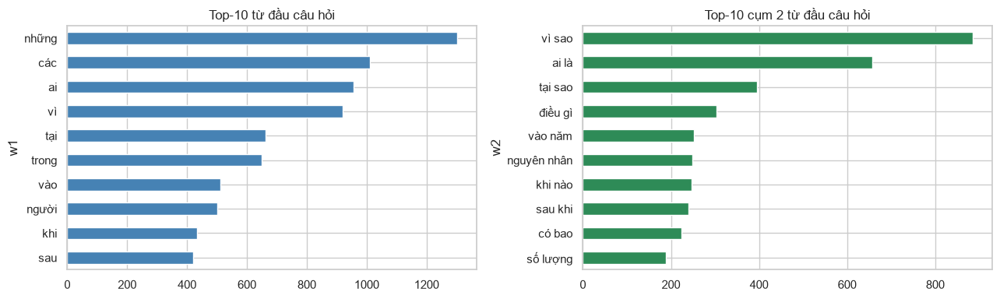

*Hình N4. Trái: 10 từ đầu câu hỏi thường gặp nhất. Phải: 10 cụm hai từ đầu câu thường gặp nhất (train sau làm sạch). Nguồn: notebooks/01_data_eda.ipynb, cell 23.*

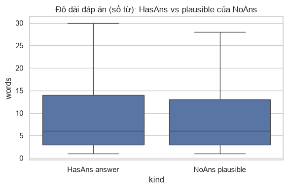

*Hình N5. Boxplot độ dài (từ) của đáp án HasAns và plausible answer của câu NoAns; cả hai có trung vị khoảng 6. Nguồn: notebooks/01_data_eda.ipynb, cell 24.*

**Diễn giải.** Câu hỏi NoAns của ViQuAD 2.0 là dạng đối kháng (viết lại câu hỏi HasAns với một chi tiết nhỏ), nên khó hơn câu hỏi vô nghĩa hoàn toàn. Ghi chú trong notebook mô tả điều này; phần lớn phân tích lỗi ở mục 12.4 phù hợp với nhận định đó.

### 4.5. Chia lại train/dev/test

**Vấn đề.** (1) Test HF không có nhãn. (2) Nếu tune ngưỡng trên validation rồi báo cáo luôn trên validation thì điểm lạc quan.

**Quyết định.** Chia train sạch theo nhóm `title` (cùng bài viết ở cùng một phía), seed 42, cố giữ tỉ lệ NoAns gần tỉ lệ chung; test mới = validation gốc.

| Split | Số mẫu | Title | Context duy nhất | NoAns (%) |
|---|---|---|---|---|
| train' | 25.542 | 127 | 3.674 | 32,35 |
| dev | 2.912 | 11 | 427 | 32,76 |
| test (= validation gốc) | 3.814 | 19 | 557 | 30,44 |
| test_unlabeled (HF test) | 7.301 | 48 | 1.241 | không có |

Nguồn: `notebooks/01_data_eda.ipynb`, cell 32 (bảng) và cell 33 (kiểm tra trùng); số NoAns (8.262 / 954 / 1.161) khớp cell 5 của notebook 02-03.

Đã kiểm tra: không trùng title/context giữa train/dev/test; chênh NoAns% giữa dev và train 0,41 điểm.

**Hệ quả quan trọng.** Dev chỉ có 11 title nên ước lượng trên dev nhiễu theo bài viết; test có 19 title. Dev có **1 đáp án tham chiếu mỗi câu** (vì lấy từ train) còn test có tới 3 (mục 13).

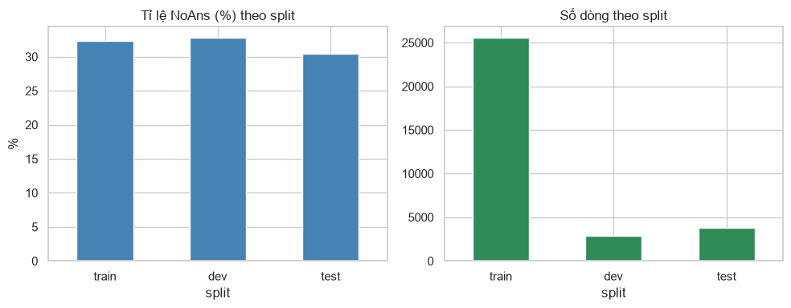

*Hình N6. Trái: % NoAns theo split sau khi chia lại. Phải: số dòng mỗi split. Nguồn: notebooks/01_data_eda.ipynb, cell 33.*

---

## 5. Bước 2: Baseline zero-shot (vi-mrc, thực hiện muộn)

Nguồn: `src/zero_shot.py`, `outputs/sweep/zero_shot/*/*/summary.json`.

**Thiết lập.** `nguyenvulebinh/vi-mrc-base` và `vi-mrc-large` được nạp bằng `AutoModelForQuestionAnswering` thường (không dùng remote code), suy luận theo đường subword của repo này (không dùng đầu "sum-features" của tác giả), cùng cửa sổ 384/128 và cùng feature với `xlmr_base` (`same_features_as_xlmr_base = True`), fp16 trên RTX 4050 6 GB. Hai repo này bị gate nên cần đăng nhập HF.

**Quan sát (dev, 2.912 mẫu, 3.075 window).**

| Mô hình | Ngưỡng 0: F1 / HasAns F1 / NoAns acc | Ngưỡng tune | F1 | EM | HasAns F1 | NoAns acc |
|---|---|---|---|---|---|---|
| vi_mrc_base | 61.88 / 88.00 / 8.28 | -9.5 | 64.45 | 52.58 | 79.04 | 34.49 |
| vi_mrc_large | 89.63 / 86.62 / 95.81 | -9.25 | 89.74 | 80.29 | 86.27 | 96.86 |

Nguồn: `outputs/sweep/zero_shot/vi_mrc_{base,large}/vi_mrc_{base,large}__zs/summary.json` (`dev.metrics_at_0`, `dev.metrics_at_best`, `dev.best_threshold`); tuned cũng có ở `notebooks/05_compare_models.ipynb`, cell 13. Đã chạy lại phép làm tròn từ `summary.json`: mọi số trong bảng khớp.

Thời gian suy luận: 40,0 s (base) và 98,5 s (large); bộ nhớ đỉnh 0,68 GB và 1,27 GB (`wall_s`, `peak_mem_gb` trong cùng `summary.json`).

**Diễn giải và điều chưa kiểm chứng.**

- Ngưỡng tuned rất âm (-9,5 và -9,25) cho thấy thang điểm null của các mô hình này khác với các mô hình tự fine-tune. Nguyên nhân (ví dụ khác biệt giữa đường suy luận subword của ta và cách tác giả cộng đặc trưng từ) là **suy đoán, chưa kiểm chứng**.
- `summary.json` ghi nhận mô hình được huấn luyện trên SQuAD2/mailong25/VLSP-MRC-2021/MLQA và "dev may overlap training (ViQuAD2.0 = VLSP 2021)". Dev F1 89.74 so với test 80.48 (mục 12.3) là bằng chứng gián tiếp của nhiễm dữ liệu.
- Số liệu của ta không đối chiếu với số trên model card của tác giả; việc lệch với card chưa được xác minh.

**Hệ quả.** Không có baseline zero-shot "sạch" cho nhóm A. Mốc so sánh có ý nghĩa cho nhóm A là lượt chạy đơn (mục 9, 10) và kết quả giai đoạn 1.

---

## 6. Bước 3: Tiền xử lý để huấn luyện (cửa sổ trượt, gán nhãn)

Nguồn: `src/preprocess.py`, `src/train_qa.py`.

**Cửa sổ trượt.** Dùng tokenizer fast với `truncation="only_second"`, `return_overflowing_tokens=True`, `stride=doc_stride` (128) và `padding="max_length"`. Ngữ cảnh dài được chia thành nhiều cửa sổ chồng lấp.

**Gán nhãn.**

- Chỉ dùng đáp án đầu tiên (`answer_start[0]`) làm nhãn huấn luyện.
- Nếu đáp án nằm trọn trong ngữ cảnh của cửa sổ, nhãn là (token bắt đầu, token kết thúc) của đáp án; nếu không, nhãn là vị trí `[CLS]`. Câu NoAns và cửa sổ không chứa đáp án đều được gán `[CLS]` (nhãn "null").
- Với `plausible_lambda > 0`, thêm hai nhãn phụ `plausible_start/plausible_end` (cùng logic cửa sổ, 0 nếu vắng mặt hoặc nằm ngoài cửa sổ) để tính hàm phạt unlikelihood (mục 11.3).

**Quan sát: số cửa sổ thực tế.**

| Mô hình | `max_length` | Train: window (window/ex) | Dev: window (window/ex) |
|---|---|---|---|
| XLM-R (base, large) | 384 | 27.324 (1,070) từ 25.542 mẫu | 3.075 (1,056) từ 2.912 mẫu |
| PhoBERT | 256 | 29.128 (1,141) từ 25.533 mẫu | 3.340 (1,147) từ 2.912 mẫu |

Nguồn: `notebooks/02_finetune_xlmr.ipynb` và `03_finetune_xlmr_large.ipynb`, cell 7 (XLM-R, hai notebook cho cùng số); `notebooks/04_finetune_phobert.ipynb`, cell 7 (PhoBERT).

Ước lượng EDA (1,068 window/ex cho 384) khớp với số thực (1,070). Với PhoBERT, ước lượng thô từ token XLM-R (1,42 ở 256) cao hơn số thực (1,141) vì PhoBERT sinh ít token hơn trên văn bản đã tách từ (mục 8).

**Hệ quả của việc gán nhãn.** Một cửa sổ chứa đáp án chỉ ở một phần bị gán `[CLS]`. Điều này làm điểm null của một cửa sổ không phản ánh "câu hỏi không có đáp án" mà chỉ là "không có đáp án trong cửa sổ này", nên hậu xử lý phải lấy min trên các cửa sổ (mục 7).

---

## 7. Bước 4: Hậu xử lý và metric

Nguồn: `src/postprocess.py`, `src/metrics.py`, `src/evalkit.py`.

### 7.1. Giải mã span và điểm null

- Với mỗi cửa sổ: lấy n-best = 20 vị trí bắt đầu và 20 vị trí kết thúc theo logit; loại span nằm ngoài ngữ cảnh, `end < start` hoặc dài hơn `max_answer_length` = 64 token; điểm span = `start_logit + end_logit`.
- Điểm null của câu hỏi = **min trên các cửa sổ** của `start[0] + end[0]` (logit tại `[CLS]`).
- `diff = null − span tốt nhất`. Dự đoán rỗng nếu `diff > threshold`.
- `max_answer_length` = 64 vì đáp án p95 = 31 từ ≈ 55 token XLM-R (EDA).

### 7.2. Ngưỡng

Ngưỡng tune trên dev bằng cách tối đa hoá F1 tổng trên lưới `linspace(-10, 10, 81)` cộng các phân vị 5%..95% của `diff`. Trên mỗi mô hình, ngưỡng được tune riêng; ensemble dùng ngưỡng của ensemble, từng seed dùng ngưỡng riêng; không tune lại trên test.

**Quan sát từ lượt chạy đơn (notebook 02-04): ngưỡng 0 so với ngưỡng tuned.**

| Mô hình (lượt chạy đơn, dev) | Ngưỡng | F1 | EM | HasAns F1 | NoAns acc |
|---|---|---|---|---|---|
| xlmr_base | 0 | 59.58 | 45.71 | 68.63 | 40.99 |
| xlmr_base | -1.00 (tuned) | 59.90 | 47.84 | 61.41 | 56.81 |
| xlmr_large | 0 | 78.12 | 62.47 | 79.88 | 74.53 |
| xlmr_large | -0.63 (tuned) | 78.30 | 62.84 | 79.06 | 76.73 |
| phobert (lr 2e-5, 3 epoch) | 0 | 66.75 | 49.93 | 75.02 | 49.79 |
| phobert (lr 2e-5, 3 epoch) | -1.50 (tuned) | 67.52 | 52.06 | 69.41 | 63.63 |

Nguồn: `notebooks/02_finetune_xlmr.ipynb` cell 9 và 13 (xlmr_base); `03_finetune_xlmr_large.ipynb` cell 9 và 13 (xlmr_large); `04_finetune_phobert.ipynb` cell 9 và 13 (phobert). Tổng hợp một chỗ ở cell 19 của notebook 04.

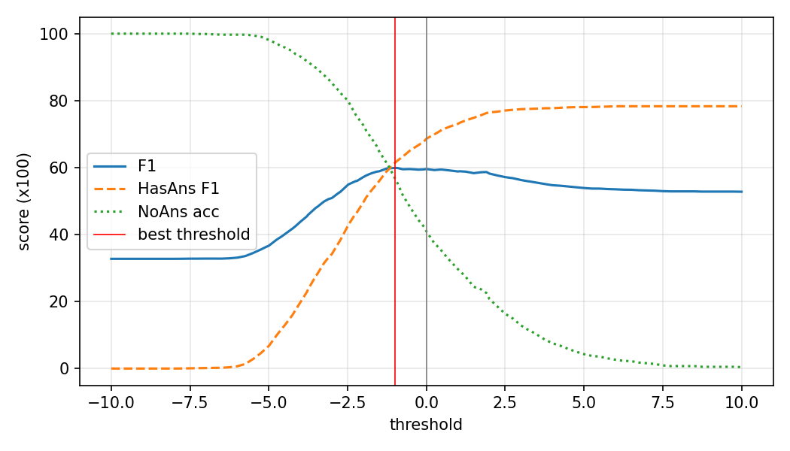

*Hình N7. xlmr_base, lượt chạy đơn: F1, HasAns F1 và NoAns acc trên dev theo ngưỡng; vạch đỏ là ngưỡng chọn (-1,00). Nguồn: notebooks/02_finetune_xlmr.ipynb, cell 15 (ô nằm dưới tiêu đề "7. Tài nguyên" nhưng nội dung là quét ngưỡng; bảng của bước này ở cell 13).*

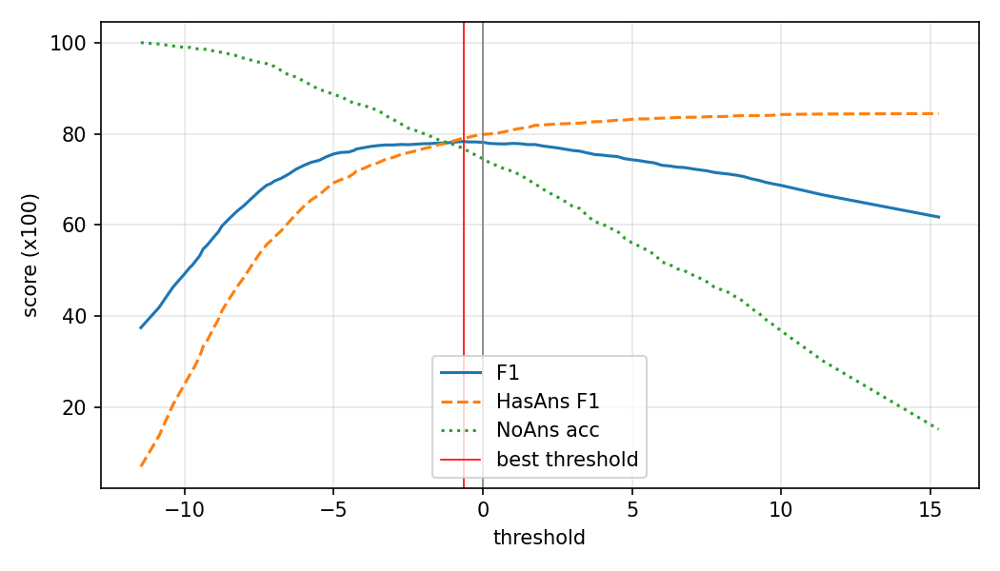

*Hình N8. xlmr_large, lượt chạy đơn: quét ngưỡng trên dev, ngưỡng chọn -0,63. Nguồn: notebooks/03_finetune_xlmr_large.ipynb, cell 13.*

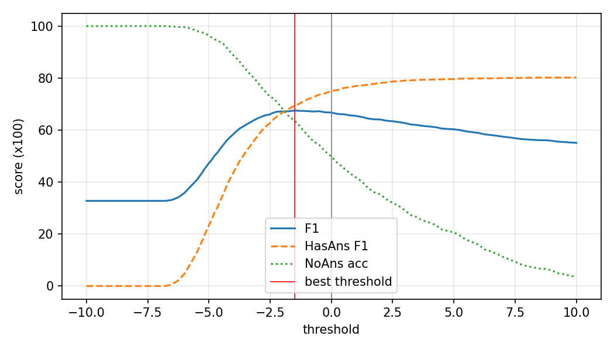

*Hình N9. phobert (lr 2e-5, 3 epoch), lượt chạy đơn: quét ngưỡng trên dev, ngưỡng chọn -1,50. Nguồn: notebooks/04_finetune_phobert.ipynb, cell 13.*

**Diễn giải.** Tune ngưỡng chỉ nâng F1 tổng 0.18-0.77 điểm nhưng chuyển mạnh cán cân HasAns/NoAns: base tăng NoAns acc từ 40.99 lên 56.81 và giảm HasAns F1 từ 68.63 xuống 61.41. Do đó chỉ số tổng che giấu một đánh đổi lớn; luôn báo cáo riêng HasAns F1 và NoAns acc.

### 7.3. Metric

`src/metrics.py` tự cài EM/F1 kiểu SQuAD-2.0, không tải gì từ hub:

- Chuẩn hoá: NFC, chữ thường, bỏ ký tự thuộc nhóm dấu câu Unicode (P*), gộp khoảng trắng. **Khác SQuAD gốc**: không bỏ mạo từ tiếng Anh (vô nghĩa với tiếng Việt); chỉ bỏ dấu câu Unicode, không bỏ các ký hiệu ASCII như `$+<=>^`|~`.
- Nhiều tham chiếu: lấy max trên các đáp án. Câu NoAns: đúng nếu và chỉ nếu mô hình trả rỗng.
- Báo cáo: EM, F1, HasAns F1, NoAns acc (độ chính xác trên câu không có đáp án).

### 7.4. Công cụ đánh giá từ logit đã lưu

`src/evalkit.py` chấm lại hoàn toàn trên CPU từ logit đã lưu: lưới biến thể hậu xử lý, ensemble (trung bình logit của các seed cùng một mô hình, kiểm tra cùng `feature_hash`), bootstrap theo ví dụ, bootstrap ghép cặp. Trong notebook 05 dùng 2.000 lần lấy mẫu lại. Logit lưu ở float16, nên chấm lại có thể lệch rất nhỏ so với điểm lúc huấn luyện (ghi nhận trong notebook 05).

---

## 8. Tokenizer: XLM-R SentencePiece so với PhoBERT BPE trên văn bản đã tách từ

### 8.1. Hai cách tokenize khác nhau về nguyên tắc

| Đặc điểm | XLM-R | PhoBERT-base-v2 |
|---|---|---|
| Thuật toán | SentencePiece (BPE trên văn bản thô) | BPE trên **văn bản đã tách từ** (VnCoreNLP), từ ghép nối bằng `_`, hậu tố `</w>` |
| Đầu vào | Văn bản gốc | Văn bản gốc phải tách từ trước |
| Số id trong tokenizer | 250.002 | 66.119 |
| Embedding của mô hình | 250.002 hàng (khớp) | 64.001 hàng (**không khớp**) |
| Offset ký tự | Có (tokenizer fast sẵn) | Phải tự dựng tokenizer fast; offset trỏ vào văn bản đã tách từ |
| Tham số (xấp xỉ, QA head tính cả) | 277,5 M (base) / 559,9 M (large) | 135,0 M |

Nguồn: tham số từ `notebooks/05_compare_models.ipynb`, cell 24 (cột `params_M`); 66.119 và 64.001 từ chú thích tại `src/phobert.py` dòng 18-19; số id 250.002, 64.001 hàng embedding và các dòng còn lại do người viết đọc từ `tokenizer`/`config` của HF khi viết báo cáo, không có file lưu (không có nguồn trong repo).

### 8.2. Ví dụ thực: một câu hỏi tiếng Việt

Câu lấy từ dev (id `0013-0001-0001`), tokenize bằng cách chạy tokenizer cục bộ (`xlm-roberta-base`, `vinai/phobert-base-v2` qua `load_phobert_tokenizer()` của repo).

- Văn bản gốc: `Đế quốc Ottoman có tên dịch nghĩa là gì ?`
- Sau VnCoreNLP: `Đế_quốc Ottoman có tên dịch nghĩa_là gì ?`

| Tokenizer | Đầu vào | Số token (cả `<s>`, `</s>`) | Chuỗi token |
|---|---|---|---|
| XLM-R | văn bản gốc | 14 | `<s>` `▁Đ` `ế` `▁quốc` `▁O` `ttoman` `▁có` `▁tên` `▁dịch` `▁nghĩa` `▁là` `▁gì` `▁?` `</s>` |
| PhoBERT | đã tách từ | 10 | `<s>` `Đế_quốc</w>` `Ottoman</w>` `có</w>` `tên</w>` `dịch</w>` `nghĩa_là</w>` `gì</w>` `?</w>` `</s>` |
| PhoBERT (kiểm chứng) | chưa tách từ | 12 | `<s>` `Đế</w>` `quốc</w>` `Ottoman</w>` `có</w>` `tên</w>` `dịch</w>` `nghĩa</w>` `là</w>` `gì</w>` `?</w>` `</s>` |

Nguồn: chạy trực tiếp tokenizer (`xlm-roberta-base`; `vinai/phobert-base-v2` qua `load_phobert_tokenizer()` trong `src/phobert.py`) trên câu `0013-0001-0001` của dev; không có notebook hay file lưu kết quả này, chạy lại được bằng lệnh đó.

**Quan sát.**

- Với câu này XLM-R cần 14 token, PhoBERT cần 10: XLM-R cắt chữ hoa có dấu `Đế` thành `▁Đ` + `ế` và `Ottoman` thành `▁O` + `ttoman`, còn PhoBERT giữ nguyên các từ.
- Từ ghép `Đế_quốc` và `nghĩa_là` là một token ở PhoBERT; nếu không tách từ, PhoBERT thấy các âm tiết rời (dòng cuối).
- Không có id ≥ 64.001 trong câu này.
- Phù hợp với số cửa sổ: dù `max_length` ngắn hơn (256 so với 384), PhoBERT chỉ cần 1,141 window/mẫu ở train, thấp hơn nhiều so với ước lượng 1,42 tính theo token XLM-R.

**Diễn giải (chưa kiểm chứng).** Tách từ có thể giúp PhoBERT biểu diễn từ ghép tiếng Việt tốt hơn, nhưng ta không có thí nghiệm kiểm soát (ví dụ PhoBERT không tách từ), nên **không khẳng định** ảnh hưởng đến độ chính xác. Một mẫu câu hỏi không đủ để kết luận về tỷ lệ token/từ nói chung.

### 8.3. Xây tokenizer fast cho PhoBERT và lỗi id ≥ 64.001

**Vấn đề 1: không có offset.** `AutoTokenizer` cho PhoBERT trả về tokenizer chậm (không có `offset_mapping`), mà cửa sổ trượt cần offset. Giải pháp (`src/phobert.py`): dựng `PreTrainedTokenizerFast.from_pretrained("vinai/phobert-base-v2", ...)` với các token đặc biệt (`<s>`, `</s>`, `<pad>`, `<unk>`, `<mask>`), đặt `model_input_names = ["input_ids", "attention_mask"]` vì RoBERTa có `type_vocab_size = 1`.

**Vấn đề 2: CUDA device-side assert.** Chạy huấn luyện PhoBERT gặp `CUDA error: device-side assert triggered`. Ban đầu nghi ngờ `token_type_ids`. **Nguyên nhân thật**: `tokenizer.json` có 66.119 id nhưng mô hình chỉ có 64.001 hàng embedding; các id ≥ 64.001 là các phép merge BPE hiếm mà tokenizer chậm gốc ánh xạ thành `<unk>`, còn tokenizer fast thì giữ nguyên id, gây truy cập ngoài bảng embedding.

**Sửa.** Đặt `tok.model_vocab_size = 64001` và trong `_tokenize` (`src/preprocess.py`) ánh xạ mọi id ≥ 64.001 thành `unk_token_id`.

**Kiểm chứng.** Kết quả của tokenizer fast sau khi ánh xạ khớp tokenizer chậm trên **37/37** mẫu kiểm tra (trong phiên làm việc). Khi viết báo cáo, chạy lại trên 40 câu hỏi đầu tiên của dev đã tách từ cho kết quả khớp **40/40** (đây là mẫu khác, ít ý nghĩa thống kê, nhưng không thấy lệch).

**Hệ quả.** Chẩn đoán sai ban đầu (`token_type_ids`) tốn thời gian; bài học là kiểm tra `max(input_ids)` so với kích thước embedding trước khi nghi ngờ các nguyên nhân khác. Chưa đo bao nhiêu phần trăm token trong tập dữ liệu rơi vào nhóm id ≥ 64.001 sau ánh xạ.

---

## 9. Bước 5: Fine-tune XLM-R (base, large)

Nguồn: notebook 02, 03, `src/train_qa.py`.

**Cấu hình lượt chạy đầu (baseline đơn).**

| Tham số | xlmr_base (nb 02) | xlmr_large (nb 03) |
|---|---|---|
| lr | 3e-5 | 1,5e-5 |
| Epoch | 3 | 3 |
| Batch | 32 | 16 × 2 (tích luỹ) = 32 |
| Warmup / weight decay | 0,1 / 0,01 | 0,1 / 0,01 |
| `max_length` / `doc_stride` | 384 / 128 | 384 / 128 |
| Chọn checkpoint | eval_loss tốt nhất theo epoch | như base |

Nguồn: `notebooks/02_finetune_xlmr.ipynb`, cell 1; `notebooks/03_finetune_xlmr_large.ipynb`, cell 1 (bảng cấu hình); cách chọn checkpoint ở cell 8 (markdown).

**Quan sát.**

| Chỉ số | xlmr_base | xlmr_large |
|---|---|---|
| Eval loss theo epoch | 1,415 / 1,264 / 1,258 | 0,988 / 0,921 / 0,920 |
| Train loss cuối | 1,083 (từ 5,855) | 0,696 (từ 5,609) |
| Thời gian huấn luyện (A100) | 4,4 phút | 12,9 phút |
| Bộ nhớ đỉnh GPU | 8,66 GB | 16,18 GB |
| Dev F1 tuned (ngưỡng) | 59.90 (-1.0) | 78.30 (-0.63) |
| Dev NoAns acc | 56.81 | 76.73 |

Nguồn: eval loss, train loss, bộ nhớ, thời gian: `notebooks/02_finetune_xlmr.ipynb` cell 9, 11, 15 và `03_finetune_xlmr_large.ipynb` cell 9, 11, 15; dev F1/NoAns: cell 13 của mỗi notebook. "Train loss cuối" là loss của bản ghi log cuối (cell 11), không phải trung bình cả lượt (`train_loss` trung bình: 1,645 và 1,234, cell 9).

Chênh lệch large so với base trên dev: F1 +18,40; NoAns acc +19,92; HasAns F1 +17,65 (`notebooks/03_finetune_xlmr_large.ipynb`, cell 19).

**Diễn giải.** Mô hình lớn phân biệt NoAns tốt hơn rõ rệt (76,73 so với 56,81), điều này nhất quán với phân tích lỗi: phần lớn lỗi nằm ở quyết định có/không có đáp án (mục 12.4). Eval loss giảm đều đến epoch cuối ở lượt chạy đầu, chưa thấy overfit.

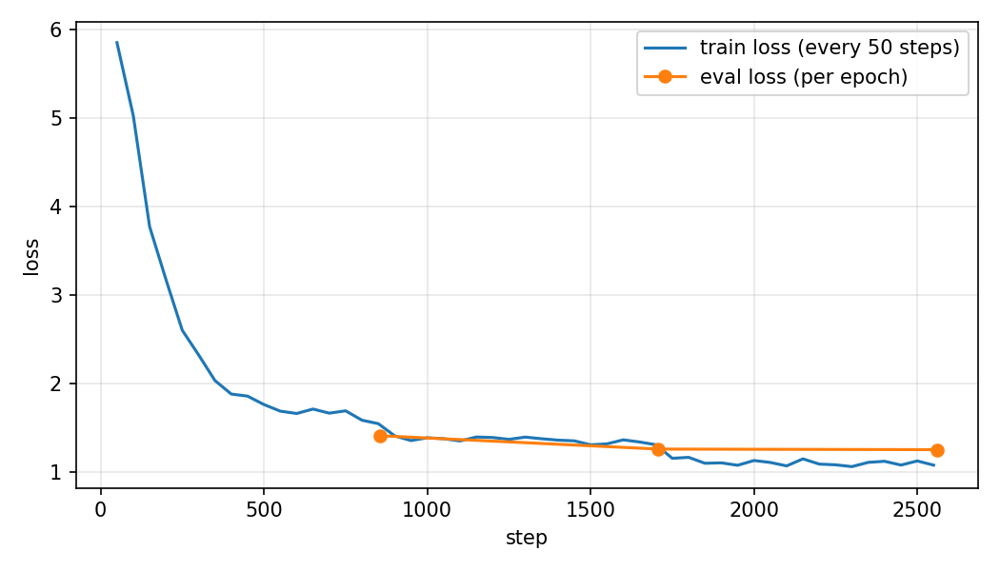

*Hình N10. xlmr_base, lượt chạy đơn (lr 3e-5, 3 epoch): train loss mỗi 50 bước và eval loss theo epoch. Nguồn: notebooks/02_finetune_xlmr.ipynb, cell 11.*

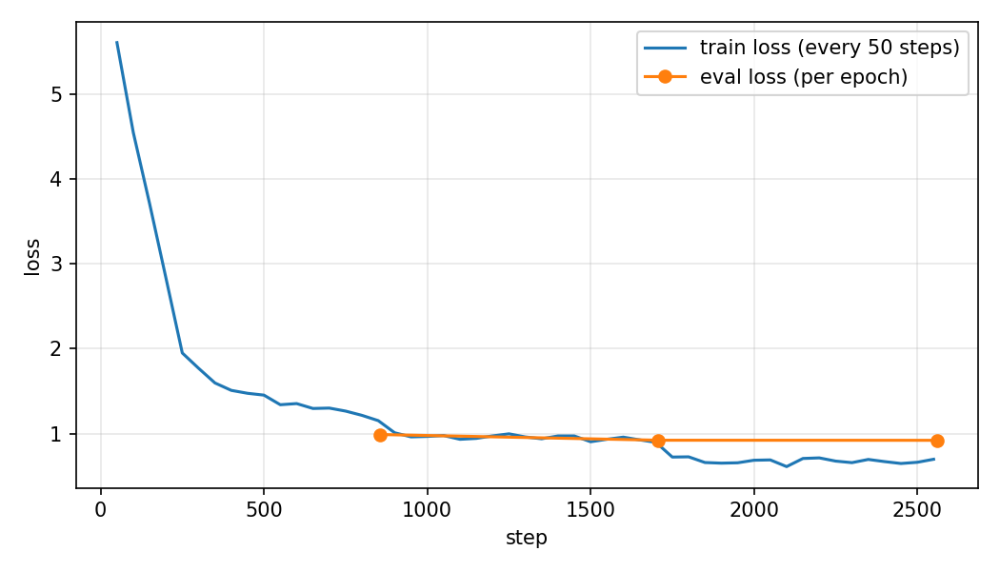

*Hình N11. xlmr_large, lượt chạy đơn (lr 1,5e-5, 3 epoch). Nguồn: notebooks/03_finetune_xlmr_large.ipynb, cell 11.*

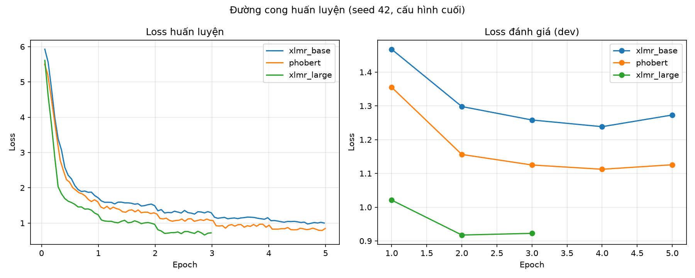

*Hình 9. Loss huấn luyện và loss dev theo epoch, chồng ba mô hình (seed 42, cấu hình cuối, giai đoạn 3 `final_s42`). Sinh bởi docs/make_figures.py từ `outputs/sweep/stage3/*/*__final_s42/summary.json` (`log_history`). Khác các hình N10, N11, N12 (lượt chạy đơn, cấu hình khác) nên không phải cùng lượt chạy.*

---

## 10. Bước 6: Fine-tune PhoBERT (tách từ, sửa tokenizer, phân kỳ)

Nguồn: notebook 04, `src/segment.py`, `src/phobert.py`.

### 10.1. Tách từ và ánh xạ offset

PhoBERT yêu cầu văn bản đã tách từ. Pipeline: VnCoreNLP `wseg` tách ngữ cảnh và câu hỏi; `align(orig, seg)` dựng hai bảng ánh xạ chỉ số ký tự (gốc → tách từ và ngược lại). Bộ tách từ chỉ chèn khoảng trắng/`_`, thỉnh thoảng dịch dấu thanh (ví dụ "hòa" thành "hoà"), nên so sánh bỏ dấu thanh, không phân biệt hoa thường. Đáp án (và plausible answer) được ánh xạ sang văn bản tách từ; khi dự đoán, span trên văn bản tách từ được ánh xạ ngược về ngữ cảnh gốc để chấm điểm (`make_extract`).

**Quan sát.**

| Split | Số mẫu sau tách từ | Ghi chú |
|---|---|---|
| train | 25.533 | 9 dòng bị loại vì lỗi căn chỉnh, đều thuộc ngữ cảnh `0101-0035-*` |
| dev | 2.912 | giữ nguyên |
| test | 3.814 | giữ nguyên |

Nguồn: số dòng train/dev/test: `notebooks/04_finetune_phobert.ipynb`, cell 5 (25.533 / 2.912 / 3.814) và `data/processed/seg/{train,dev,test}.jsonl` (đếm lại: 25.533 / 2.912 / 3.814). Số "9 dòng loại, thuộc ngữ cảnh `0101-0035-*`" là 25.542 - 25.533 (khớp); việc chúng cùng một ngữ cảnh không có file nguồn trong repo (từ trao đổi).

- Khoảng 1,7% đến 2,3% ranh giới đáp án nằm giữa một từ đã tách, do đó EM tối đa trên dev xấp xỉ 98,3% (không có nguồn trong repo, từ trao đổi; chưa tính lại).
- Plausible answer còn lại sau tách từ: train 8.257, dev 954, test 1.160 (đếm lại từ `data/processed/seg/*.jsonl`: khớp).
- Có chốt chặn `MAX_ALIGN_FAIL_RATE = 0,005`: nếu lỗi căn chỉnh vượt 0,5% số dòng thì tách từ báo lỗi.

### 10.2. Rà soát căn chỉnh và các lỗi đã sửa

Một đợt rà soát code căn chỉnh tìm ra ba lỗi, đã sửa: (1) so khớp ký tự quá lỏng (bằng nhau theo chữ cái, bỏ qua khác biệt thật); (2) lệch một vị trí (off-by-one) ở biên span; (3) rơi xuống nhánh dự phòng một cách im lặng khi căn chỉnh thất bại. Hiện nay lỗi căn chỉnh ném `AlignError`, dòng train lỗi bị loại và được ghi `align_error_ids`; dòng dev/test lỗi được giữ lại với cờ `align_error`.

**Hệ quả.** Nhờ rà soát, số dòng bị loại chỉ còn 9/25.542 (0,035%) và đều tập trung vào một ngữ cảnh. Điều này nghĩa là không có sai số hệ thống lớn do căn chỉnh nhưng **tỉ lệ ranh giới giữa từ (~2%) vẫn là trần cứng** với PhoBERT.

### 10.3. Sự cố CUDA và tokenizer

Xem mục 8.3 (id ≥ 64.001 bị ánh xạ thành `<unk>`).

### 10.4. Phân kỳ ở lr 3e-5

**Quan sát.** Lượt chạy PhoBERT với lr 3e-5 (3 epoch, seed 42, batch 32) phân kỳ. Log của lượt này vẫn còn trong `outputs/phobert_base_out.tar` (`train_summary.json`): `grad_norm` là 52,2 ở bước 1850 rồi đạt đỉnh **532,45 ở bước 1900** (trước đó 10,7 ở bước 1800); loss tăng từ 1,16 (bước 1800) lên 2,23 (bước 2000); eval loss 1,227 / 1,796 / 2,598 qua ba epoch; dev F1 ở ngưỡng 0 là 59,50 (EM 43,20, NoAns acc 29,14). Chú thích trong `notebooks/04_finetune_phobert.ipynb` (cell 1) ghi "bước ~1850", khớp đoạn bắt đầu tăng. Giai đoạn 1 có một lượt lr 3e-5 khác (5 epoch, warmup 0,2) không phân kỳ (F1 dev 67.38, `outputs/sweep/stage1/phobert/results.jsonl`), nên "lr 3e-5 phân kỳ" không đúng chung cho mọi cấu hình lr 3e-5.

Nguồn: `outputs/phobert_base_out.tar` (`train_summary.json` -> `log_history`; `dev_threshold.json` -> `metrics_at_0`); `notebooks/04_finetune_phobert.ipynb`, cell 1 (chú thích).

**Quyết định.** Đổi sang lr 2e-5 cho lượt chạy đơn (notebook 04). Lượt chạy này ổn định: `grad_norm` đạt đỉnh 22,98 ở epoch 0,27 (giai đoạn warmup); sau đó trung bình theo epoch khoảng 12-14 (min 9,3, max 21,7), tính từ `notebooks/04_finetune_phobert.ipynb`, cell 9.

**Kết quả lượt chạy đơn lr 2e-5, 3 epoch.** Eval loss 1,275 / 1,118 / 1,107; huấn luyện 3,0 phút, bộ nhớ đỉnh 5,22 GB; dev F1 67.52 (ngưỡng -1.50), EM 52.06, HasAns F1 69.41, NoAns acc 63.63. So với XLM-R base cùng ngân sách: +7,62 F1, +6,82 NoAns acc; so với XLM-R large: -10,78 F1.

Nguồn: `notebooks/04_finetune_phobert.ipynb`, cell 9 (eval loss, dev), cell 15 (thời gian, bộ nhớ), cell 19 (so sánh với base/large).

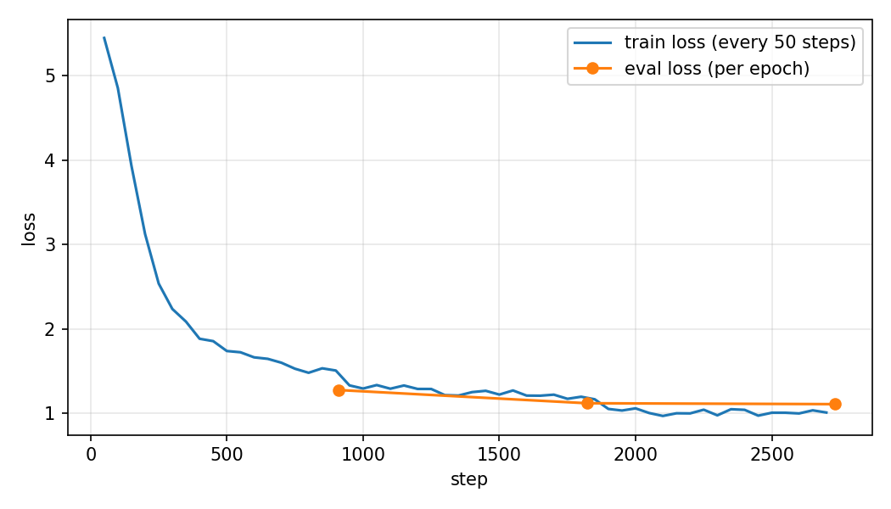

*Hình N12. phobert, lượt chạy đơn (lr 2e-5, 3 epoch): train loss và eval loss. Nguồn: notebooks/04_finetune_phobert.ipynb, cell 11.*

**Diễn giải.** Một lượt lr 3e-5 phân kỳ (log trong `outputs/phobert_base_out.tar`) gợi ý PhoBERT nhạy với lr cao hơn XLM-R base. Giai đoạn 1 cho thấy lr thấp hơn (1,5e-5) có F1 dev cao nhất cho PhoBERT (68.32), nhưng chỉ hơn lượt lr 2e-5, 3 epoch (67.64) 0,68 điểm trên một seed, nhỏ hơn nhiễu giữa seed (mục 11.1, 11.4).

---

## 11. Chương trình cải thiện công bằng (giai đoạn 1-4)

Sau lượt chạy đơn, nhóm lập chương trình bốn giai đoạn để so sánh các mô hình nhóm A với ngân sách tinh chỉnh bằng nhau và để biết mức nhiễu giữa các seed. Cấu hình ở `configs/sweep_stage1.json`, `sweep_stage2.json`, `sweep_stage3.json`; chạy bằng `src/sweep.py`.

### 11.1. Giai đoạn 1: quét siêu tham số (seed 42, 4 cấu hình/mô hình)

**Quan sát** (dev F1 sau khi tune ngưỡng; NoAns acc cũng ở ngưỡng đó).

| Mô hình | Cấu hình | F1 dev | EM dev | NoAns acc | Thời gian (s) | Chọn |
|---|---|---|---|---|---|---|
| xlmr_base | lr 3e-5, 3 epoch | 60.22 | 46.05 | 47.69 | 262 | |
| xlmr_base | lr 2e-5, 5 epoch | 61.53 | 48.11 | 57.23 | 430 | có |
| xlmr_base | lr 3e-5, 5 epoch | 61.38 | 47.91 | 54.61 | 430 | |
| xlmr_base | lr 5e-5, 4 epoch | 57.80 | 45.02 | 46.02 | 344 | |
| phobert | lr 2e-5, 3 epoch | 67.64 | 52.30 | 63.31 | 174 | |
| phobert | lr 2e-5, 5 epoch | 66.49 | 50.52 | 55.03 | 293 | |
| phobert | lr 3e-5, 5 epoch, warmup 0,2 | 67.38 | 51.17 | 55.35 | 293 | |
| phobert | lr 1,5e-5, 5 epoch | 68.32 | 51.99 | 59.01 | 295 | có |
| xlmr_large | lr 1,5e-5, 3 epoch | 77.39 | 62.67 | 78.41 | 772 | có |
| xlmr_large | lr 1e-5, 4 epoch | 76.48 | 60.92 | 74.42 | 1.034 | |
| xlmr_large | lr 2e-5, 3 epoch | 77.25 | 62.33 | 79.35 | 776 | |
| xlmr_large | lr 1,5e-5, 5 epoch | 77.15 | 62.12 | 77.25 | 1.293 | |

(Cột "Thời gian" là thời gian huấn luyện; cộng thêm khoảng 20-50 giây tải và chấm dev.)

Nguồn: `outputs/sweep/stage1/{xlmr_base,phobert,xlmr_large}/results.jsonl` (trường `f1_tuned`, `em_tuned`, `noans_acc_tuned`, `train_runtime_s`); cùng số ở `notebooks/05_compare_models.ipynb`, cell 3. Đã tính lại từ jsonl: khớp toàn bộ.

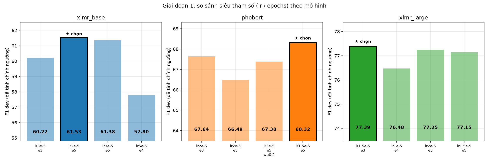

*Hình 1. F1 dev theo cấu hình siêu tham số, mỗi mô hình một ô. Sinh bởi docs/make_figures.py từ `outputs/sweep/stage1/*/results.jsonl`.*

**Quan sát bổ sung.** Chênh giữa cấu hình tốt nhất và tệ nhất trong cùng mô hình: xlmr_base 3,73 (lr 5e-5 tệ nhất); phobert 1,83; xlmr_large 0,91. Với `xlmr_large` bốn cấu hình nằm trong 1 điểm, với `xlmr_base` và `phobert` các chênh lệch lớn hơn nhưng các lượt đều là một seed.

**Quyết định.** Chọn cấu hình F1 dev cao nhất cho mỗi mô hình. **Cảnh báo:** đây là chọn trên một seed, nhiễu giữa seed (độ lệch chuẩn 0,3 đến 1,8 ở giai đoạn 3) lớn hơn nhiều khoảng cách giữa các cấu hình lân cận (ví dụ 61,53 và 61,38 ở xlmr_base, 77,39 và 77,25 ở xlmr_large), nên thứ hạng giữa các cấu hình sát nhau không đáng tin; chỉ các khoảng cách lớn (lr 5e-5 ở xlmr_base) mới có ý nghĩa.

### 11.2. Cấu hình cuối cho mỗi mô hình

| Mô hình | lr | Epoch | Batch | Các thành phần thêm |
|---|---|---|---|---|
| xlmr_base | 2e-5 | 5 | 32 | plausible λ = 0,3 |
| phobert | 1,5e-5 | 5 | 32 | không (cấu hình thuần) |
| xlmr_large | 1,5e-5 | 3 | 16 (× 2 tích luỹ) | plausible λ = 0,3 |

Nguồn: `notebooks/05_compare_models.ipynb`, cell 7 (bảng công thức cuối: lr, epochs, train_bs, lr_decay, ema_decay, plausible_lambda; `train_bs` của xlmr_large là 16 và `grad_accum` 2 theo `src/sweep.py` hàm `base_cfg`).

### 11.3. Giai đoạn 2: các kỹ thuật bổ sung trên cấu hình đã chọn (seed 42)

Ba kỹ thuật được thử, mỗi cái trên cấu hình giai đoạn 1 đã chọn:

- **LLRD (layer-wise lr decay), hệ số 0,9**: lr của lớp thứ i giảm dần về phía embedding (`src/train_qa.py`, `llrd_param_groups`).
- **EMA 0,999**: trung bình trượt tham số, dùng cho đánh giá/lưu checkpoint.
- **Plausible-answer unlikelihood, λ ∈ {0,1; 0,3}**: phạt `-log(1-p_start[ps]) - log(1-p_end[pe])` trên plausible span của câu NoAns, để mô hình không chỉ vào "đáp án bẫy". Ý tưởng: NoAns của ViQuAD 2.0 là câu hỏi bị sửa nhỏ, và plausible answer là đáp án của câu gốc.

**Quan sát** (F1 dev tuned / NoAns acc; "cơ sở" = kết quả giai đoạn 1 của cấu hình đã chọn).

| Mô hình | Cơ sở | LLRD 0,9 | EMA 0,999 | plausible λ 0,1 | plausible λ 0,3 |
|---|---|---|---|---|---|
| xlmr_base | 61.53 / 57.2 | 59.85 / 45.2 | 60.25 / 43.8 | 61.58 / 50.1 | 62.30 / 51.4 |
| phobert | 68.32 / 59.0 | 65.55 / 52.0 | 62.47 / 39.3 | 64.51 / 50.2 | 67.57 / 59.2 |
| xlmr_large | 77.39 / 78.4 | 75.43 / 73.0 | 76.89 / 73.6 | 77.15 / 78.8 | 78.16 / 82.4 |

Nguồn: `outputs/sweep/stage2/*/results.jsonl` (`f1_tuned`, `noans_acc_tuned`) và cột "Cơ sở" từ `outputs/sweep/stage1/*/results.jsonl` (lượt đã chọn); cùng số ở `notebooks/05_compare_models.ipynb`, cell 3. Đã tính lại: khớp toàn bộ.

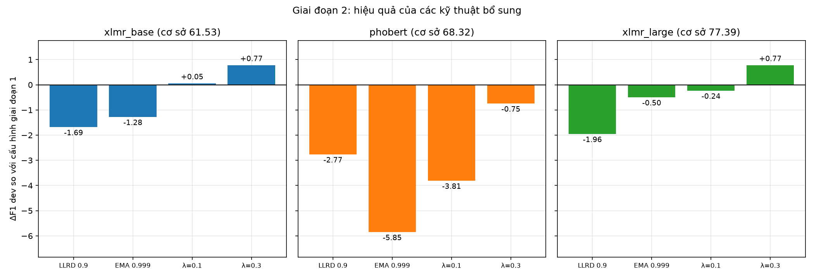

*Hình 2. F1 dev của các kỹ thuật bổ sung so với cơ sở (đường tham chiếu). Sinh bởi docs/make_figures.py từ `outputs/sweep/stage2/*/results.jsonl` và `stage1`.*

**Quan sát bổ sung.**

- LLRD và EMA làm F1 giảm ở cả ba mô hình (từ -0,5 đến -5,9; EMA ở PhoBERT thấp nhất, 62,47).
- λ = 0,3 cho +0,8 F1 ở xlmr_base (62,30 so với 61,53) và xlmr_large (78,16 so với 77,39), nhưng "+0,8" này là nhiễu: cùng cấu hình và seed 42 của xlmr_large cho 76,92 ở giai đoạn 3 (mục 11.4). PhoBERT giảm 0,75 (67,57 so với 68,32). NoAns acc của xlmr_large tăng 78,4 lên 82,4 ở ngưỡng tuned, HasAns F1 giảm (76,89 xuống 76,10).
- Chi phí giai đoạn này theo `outputs/sweep/stage2/*/results.jsonl`: tổng ước tính **12,19** đơn vị (xlmr_base 3,52, phobert 2,53, xlmr_large 6,14), cộng `est_units` của 12 lượt thành công. Con số "khoảng 9" ở bản trước không có nguồn và đã bỏ (mục 22).

**Quyết định.** Bỏ LLRD và EMA. Giữ λ = 0,3 cho hai mô hình XLM-R (PhoBERT không dùng); lượt "combo" (kết hợp nhiều kỹ thuật) đã dự kiến nhưng bỏ vì không có kỹ thuật riêng lẻ nào ổn định.

**Điều chưa kiểm chứng.** LLRD chỉ thử hệ số 0,9; với mô hình 24 lớp như xlmr_large, 0,9 có thể quá mạnh (lr lớp đầu = lr × 0,9^25 ≈ 0,07 lr). Không có thử 0,95 hay 0,98, nên kết luận "LLRD không giúp" chỉ đúng cho giá trị đã thử.

### 11.4. Giai đoạn 3: lặp 3 seed (42, 43, 44) với cấu hình đóng băng

**Quan sát** (F1 dev tuned của từng seed).

| Mô hình | Seed 42 | Seed 43 | Seed 44 | Trung bình | Độ lệch chuẩn (n-1) |
|---|---|---|---|---|---|
| xlmr_base | 62.30 | 63.06 | 59.69 | 61.68 | 1.77 |
| phobert | 68.31 | 66.45 | 68.41 | 67.72 | 1.10 |
| xlmr_large | 76.92 | 77.13 | 77.55 | 77.20 | 0.32 |

Nguồn: `outputs/sweep/stage3/*/results.jsonl` (`f1_tuned` của `final_s42/43/44`); trung bình và độ lệch chuẩn khớp `notebooks/05_compare_models.ipynb`, cell 7. Đã tính lại: khớp.

(Số của notebook 05 hơi khác ở một vài ô, ví dụ xlmr_large 76.9 / 77.12 / 77.59, vì notebook tune lại ngưỡng khi dùng biến thể đã chọn; trung bình vẫn là 77.20.)

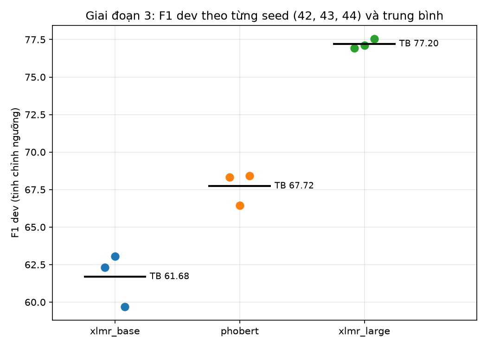

*Hình 3: F1 dev của từng seed và trung bình theo mô hình.*

**Quan sát: λ = 0,3 không giữ được.**

| Mô hình | F1 gốc (giai đoạn 1, 1 seed) | F1 λ = 0,3 (giai đoạn 2, seed 42) | Trung bình 3 seed (giai đoạn 3) |
|---|---|---|---|
| xlmr_base | 61.53 | 62.30 | 61.68 |
| xlmr_large | 77.39 | 78.16 | 77.20 |

Nguồn: `outputs/sweep/stage1/xlmr_*/results.jsonl` (lượt đã chọn), `stage2/*/results.jsonl` (`pl0.3`), `stage3/*/results.jsonl` (trung bình `final_s42/43/44`); `notebooks/05_compare_models.ipynb`, cell 3 và cell 7.

- Với xlmr_base: trung bình 3 seed (61,68) gần bằng cơ sở không có λ (61,53), chênh 0,15, thấp hơn nhiều so với độ lệch chuẩn giữa seed (1,77).
- Với xlmr_large: trung bình (77,20) thậm chí thấp hơn cơ sở một seed (77,39). Lượt giai đoạn 2 (78,16) và lượt seed 42 giai đoạn 3 (76,92) có **cùng cấu hình và cùng seed** nhưng khác nhau 1,24 điểm. Ở `xlmr_base` và `phobert` các lượt trùng cấu hình/seed cho kết quả trùng hoặc gần trùng (62,30 và 62,30; 68,32 và 68,31). Nguyên nhân sai khác ở xlmr_large **chưa giải thích được**. Đã kiểm `src/train_qa.py`: seed, `data_seed` và `set_seed` đều được đặt, nhưng không bật chế độ tất định (không có `use_deterministic_algorithms`) và huấn luyện dùng bf16; nên có thể có nhiễu số học giữa hai lượt, song chưa chạy lại để kiểm chứng. Hệ quả cho kết luận: "+0,8" của λ = 0,3 ở giai đoạn 2 nhỏ hơn mức nhiễu 1,24 giữa hai lượt cùng cấu hình, tức là nhiễu, không phải tác dụng của λ.

**Diễn giải.** "+0,8 F1" của λ = 0,3 ở giai đoạn 2 nằm trong mức nhiễu giữa lần chạy; không có bằng chứng để nói λ giúp hay hại. Công thức cuối vẫn dùng λ = 0,3 cho hai mô hình XLM-R vì đã đóng băng trước khi có kết quả 3 seed (mục 15), và không có bằng chứng nó gây hại.

### 11.5. Giai đoạn 4: lưới hậu xử lý và ensemble seed (trên dev)

**Lưới hậu xử lý.** 18 biến thể = điểm null {min, mean, first} × `max_answer_length` {30, 64, 96} × `n_best` {20, 50}, chấm trên ensemble 3 seed của mỗi mô hình, ngưỡng tune lại cho từng biến thể. Quy tắc: nếu biến thể tốt nhất chỉ hơn mặc định (min / 64 / 20) tối đa 0,3 F1 thì giữ mặc định.

| Mô hình | F1 mặc định (min/64/20) | Biến thể tốt nhất trong lưới | F1 tốt nhất | Chênh | Kết luận |
|---|---|---|---|---|---|
| xlmr_base | 62.87 | mean / 96 / 20, ngưỡng 0,5 | 63.01 | +0,14 | giữ mặc định |
| phobert | 68.75 | mean / 64 / 50, ngưỡng -1,50 | 68.77 | +0,02 | giữ mặc định |
| xlmr_large | 78.86 | (trùng mặc định) | 78.86 | 0 | giữ mặc định |

Nguồn: `notebooks/05_compare_models.ipynb`, cell 9 (lưới 18 biến thể, 6 dòng đầu mỗi mô hình). Đã đối chiếu: khớp.

**Ensemble seed (trung bình logit của 3 seed, dev).**

| Mô hình | F1 trung bình từng seed | F1 ensemble [CI 95%] | Lợi ích so với trung bình seed | EM | HasAns F1 | NoAns acc | Ngưỡng |
|---|---|---|---|---|---|---|---|
| xlmr_base | 61.68 | 62.87 [61.19, 64.38] | +1,19 | 49.04 | 66.33 | 55.77 | 0,500 |
| phobert | 67.72 | 68.75 [67.20, 70.29] | +1,03 | 52.99 | 71.61 | 62.89 | -1,694 |
| xlmr_large | 77.20 | 78.86 [77.50, 80.17] | +1,65 | 63.43 | 79.79 | 76.94 | 0,282 |

Nguồn: `notebooks/05_compare_models.ipynb`, cell 11 (F1 trung bình seed, ensemble, EM, HasAns, NoAns) và cell 15 (CI dev); ngưỡng ở cell 9.

**Kiểm định ghép cặp trên dev** (hiệu F1, khoảng tin cậy 95%, bootstrap 2.000 lần):

| Cặp (A so với B) | Hiệu F1 | CI 95% |
|---|---|---|
| xlmr_base - phobert | -5,89 | [-7,47, -4,36] |
| xlmr_base - xlmr_large | -15,99 | [-17,64, -14,39] |
| phobert - xlmr_large | -10,10 | [-11,71, -8,58] |

Nguồn: `notebooks/05_compare_models.ipynb`, cell 15 (kiểm định ghép cặp trên dev).

Tức là xlmr_large hơn phobert 10,1 F1 [8,6; 11,7] và phobert hơn xlmr_base 5,9 F1 [4,4; 7,5] trên dev.

**Diễn giải.** Kết quả hậu xử lý "không đáng kể" (nhỏ hơn nhiễu của ngưỡng) cho thấy chất lượng nằm ở mô hình, không ở cách giải mã. Ensemble 3 seed cho thêm khoảng 1-1,7 F1; vì cùng công thức nên được phép trong từng mô hình, nhưng **cũng nghĩa là F1 ensemble không so sánh được với F1 của một mô hình đơn** (xem cả F1 trung bình từng seed ở mục 12).

### 11.6. Giao thức đóng băng

Chốt trên dev, không đổi sau khi thấy test:

1. Công thức cuối: các lượt `final_s42/43/44` ở giai đoạn 3 với siêu tham số ở mục 11.2.
2. Ensemble = trung bình logit của 3 seed (42, 43, 44).
3. Biến thể hậu xử lý: `min / max_answer_length = 64 / n_best = 20`.
4. Ngưỡng no-answer tune trên dev (ensemble dùng ngưỡng ensemble, từng seed dùng ngưỡng riêng); không tune lại trên test.
5. Nhóm B: một lượt, biến thể mặc định, ngưỡng dev.
6. Test được chấm một lần, chỉ khi cờ `RUN_TEST=True` được bật thủ công. Trong giai đoạn dev cờ này tắt.

---

## 12. Bước 7: Đánh giá trên test, so sánh và phân tích lỗi

### 12.1. Kết quả test

**Quan sát.** Test = 3.814 mẫu (2.653 HasAns, 1.161 NoAns). Nhóm A: ensemble 3 seed. Nhóm B: một lượt, ngưỡng tuned trên dev. CI = bootstrap 95% theo ví dụ.

| Mô hình | F1 [CI 95%] | EM [CI 95%] | HasAns F1 [CI 95%] | NoAns acc [CI 95%] |
|---|---|---|---|---|
| xlmr_base | 62.40 [60.89, 63.78] | 53.99 [52.31, 55.56] | 64.15 [62.48, 65.73] | 58.40 [55.64, 60.98] |
| phobert | 68.97 [67.63, 70.33] | 59.49 [57.94, 61.01] | 71.18 [69.68, 72.72] | 63.91 [61.15, 66.58] |
| xlmr_large | 77.89 [76.68, 79.15] | 68.35 [66.91, 69.90] | 78.39 [77.01, 79.74] | 76.74 [74.33, 79.16] |
| vi_mrc_base (tham chiếu) | 64.72 [63.25, 66.18] | 57.26 [55.69, 58.86] | 77.43 [75.93, 78.87] | 35.66 [32.99, 38.42] |
| vi_mrc_large (tham chiếu) | 80.48 [79.33, 81.63] | 68.90 [67.46, 70.35] | 86.45 [85.40, 87.49] | 66.84 [64.17, 69.60] |

Nguồn: `notebooks/05_compare_models.ipynb`, cell 19 (bảng CI test). Đã đối chiếu: khớp.

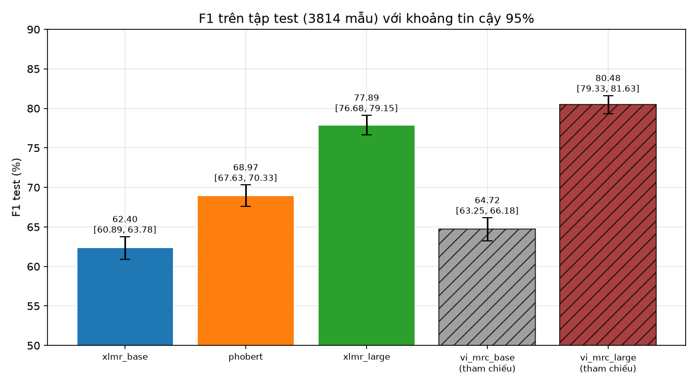

*Hình 4: F1 trên test với khoảng tin cậy 95%.*

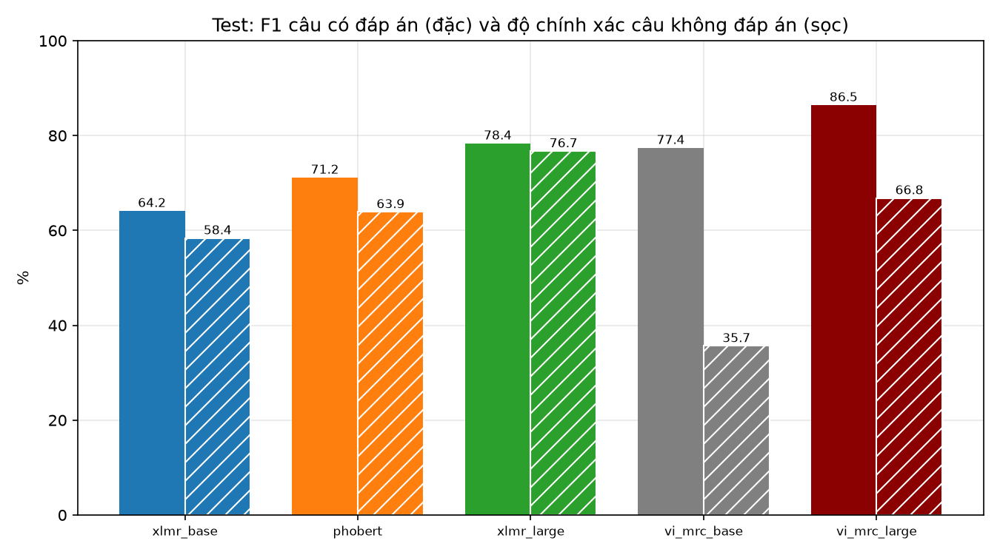

*Hình 6: F1 câu có đáp án và độ chính xác câu không có đáp án trên test.*

**Từng seed riêng trên test** (ngưỡng dev của từng seed, trung bình ± độ lệch chuẩn qua 3 seed):

| Mô hình | F1 trung bình ± std | EM trung bình ± std | F1 ensemble | Chênh ensemble so với trung bình seed |
|---|---|---|---|---|
| xlmr_base | 61.95 ± 1.25 | 52.81 ± 1.01 | 62.40 | +0,45 |
| phobert | 67.38 ± 0.78 | 57.94 ± 0.37 | 68.97 | +1,59 |
| xlmr_large | 76.40 ± 1.25 | 66.61 ± 0.93 | 77.89 | +1,49 |

Nguồn: `notebooks/05_compare_models.ipynb`, cell 17 (F1 từng seed ± std, F1 ensemble) và cell 19 (EM từng seed ± std). Cột chênh = F1 ensemble trừ F1 trung bình seed.

**Kiểm định ghép cặp trên test** (hiệu F1, CI 95%; bootstrap theo ví dụ 2.000 lần):

| Cặp (A so với B) | Hiệu F1 | CI 95% | Hiệu EM | CI 95% EM |
|---|---|---|---|---|
| xlmr_base - phobert | -6.57 | [-7.97, -5.16] | -5.51 | [-7.05, -4.04] |
| xlmr_base - xlmr_large | -15.49 | [-16.99, -14.00] | -14.37 | [-15.94, -12.82] |
| phobert - xlmr_large | -8.92 | [-10.25, -7.57] | -8.86 | [-10.38, -7.37] |
| xlmr_large - vi_mrc_large (tham chiếu) | -2.59 | [-3.99, -1.11] | -0.55 | [-2.47, 1.36] |

Nguồn: `notebooks/05_compare_models.ipynb`, cell 20 (kiểm định ghép cặp trên test; cell 20 còn có cặp với `vi_mrc_large` cho hai mô hình khác, không trích ở đây).

**Diễn giải.**

- Trong nhóm A, thứ tự xlmr_large > phobert > xlmr_base có ý nghĩa thống kê theo bootstrap ví dụ (mọi CI ghép cặp không chứa 0), và trùng với thứ tự trên dev.
- xlmr_large kém `vi_mrc_large` 2,59 F1 (CI không chứa 0), nhưng EM chênh -0,55 với CI chứa 0, tức **không phân biệt được về EM**. Do `vi_mrc_large` được huấn luyện trên dữ liệu ngoài (nhóm B), đây không phải so sánh công bằng.
- Hồ sơ lỗi khác nhau: `vi_mrc_*` có HasAns F1 cao (77,43 và 86,45) nhưng NoAns acc thấp (35,66 và 66,84), trong khi xlmr_large cân bằng hơn (78,39 / 76,74). `vi_mrc_base` đặc biệt thiên về luôn trả lời. Sự khác biệt này có thể do ngưỡng/thang điểm khác (mục 5), chưa kiểm chứng.
- CI chỉ phản ánh phương sai do chọn mẫu ví dụ, không phải phương sai huấn luyện (3 seed là rất ít).

### 12.2. Dev so với test (đồ thị)

Bảng số liệu ở mục 12.3; hình dưới cho thấy F1 dev và test của cùng mô hình gần nhau ở nhóm A và lệch rõ ở `vi_mrc_large`.

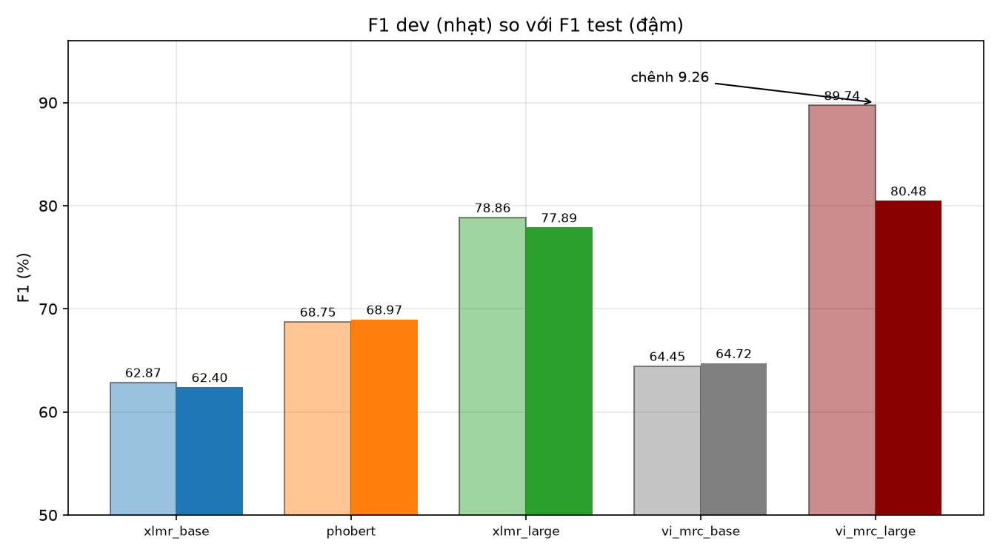

*Hình 5: F1 dev (nhạt) so với F1 test (đậm).*

### 12.3. Dev so với test

| Mô hình | F1 dev | F1 test | Chênh F1 (dev - test) | EM dev | EM test | Chênh EM (dev - test) |
|---|---|---|---|---|---|---|
| xlmr_base | 62.87 | 62.40 | 0,47 | 49.04 | 53.99 | -4,95 |
| phobert | 68.75 | 68.97 | -0,21 | 52.99 | 59.49 | -6,50 |
| xlmr_large | 78.86 | 77.89 | 0,97 | 63.43 | 68.35 | -4,93 |
| vi_mrc_base | 64.45 | 64.72 | -0,27 | 52.58 | 57.26 | -4,69 |
| vi_mrc_large | 89.74 | 80.48 | 9,26 | 80.29 | 68.90 | 11,38 |

Nguồn: `notebooks/05_compare_models.ipynb`, cell 22 (bảng dev so với test). Đã đối chiếu: khớp.

**Quan sát.**

- Nhóm A: F1 dev và test chênh dưới 1 điểm theo cả hai hướng. Ngưỡng và biến thể tuned trên dev **không** bị quá khớp rõ rệt trên test.
- `vi_mrc_large`: F1 dev cao hơn test 9,26 điểm, EM cao hơn 11,38 điểm, trong khi `vi_mrc_base` không lệch (-0,27). Đây là dấu hiệu dev đã bị nhiễm bởi dữ liệu huấn luyện của `vi_mrc_large` (VLSP-MRC-2021 chứa dữ liệu ViQuAD 2.0 train). Nhiễm là suy luận từ độ chênh dev/test và từ ghi chú trong `summary.json`, không phải kiểm chứng trực tiếp trùng mẫu.
- **EM test cao hơn EM dev khoảng 5 điểm ở mọi mô hình nhóm A và `vi_mrc_base`** (4,69-6,50), trong khi F1 gần bằng nhau.

**Diễn giải (chưa kiểm chứng).** Nhiều khả năng do test có tới ba đáp án tham chiếu cho 32,25% số dòng (1.230/3.814), còn dev chỉ có một; có nhiều tham chiếu thì khả năng khớp chính xác tăng. Chưa chạy thí nghiệm kiểm soát (ví dụ chấm test chỉ với tham chiếu đầu) để xác nhận. Hệ quả: **không so EM giữa dev và test**.

### 12.4. Phân tích lỗi (xlmr_large, ensemble, test)

Nguồn: notebook 06. Chỉ đọc lại dự đoán test đã đóng băng để mô tả lỗi, không đổi cấu hình. Mỗi mẫu có EM = 0 được gán đúng một nhóm.

| Nhóm lỗi | Số lỗi | % lỗi | % toàn test |
|---|---|---|---|
| (a) NoAns nhưng mô hình vẫn trả lời | 270 | 22,37 | 7,08 |
| (b) HasAns nhưng mô hình đoán rỗng | 316 | 26,18 | 8,29 |
| (c) Giao span nhưng lệch biên | 478 | 39,60 | 12,53 |
| (d) Sai chỗ | 143 | 11,85 | 3,75 |
| Tổng lỗi (EM = 0) | 1.207 | 100,00 | 31,65 |

Nguồn: `notebooks/06_error_analysis.ipynb`, cell 5 (bảng nhóm lỗi). Đã đối chiếu: khớp.

Phân nhỏ:

| Nhóm | Nhóm con | Số lỗi | % lỗi |
|---|---|---|---|
| (a) | trùng plausible answer của dữ liệu | 143 | 11,85 |
| (a) | khác plausible answer | 127 | 10,52 |
| (c) | super-span (chứa trọn đáp án vàng) | 256 | 21,21 |
| (c) | sub-span (nằm trọn trong đáp án vàng) | 213 | 17,65 |
| (c) | lệch một phần (shifted) | 9 | 0,75 |
| (d) | câu khác | 105 | 8,70 |
| (d) | cùng câu | 38 | 3,15 |

Nguồn: `notebooks/06_error_analysis.ipynb`, cell 5 (bảng phân nhỏ); F1 trung bình 0,72 của nhóm (c) và 143/270 ở cell 12. Đã đối chiếu: khớp.

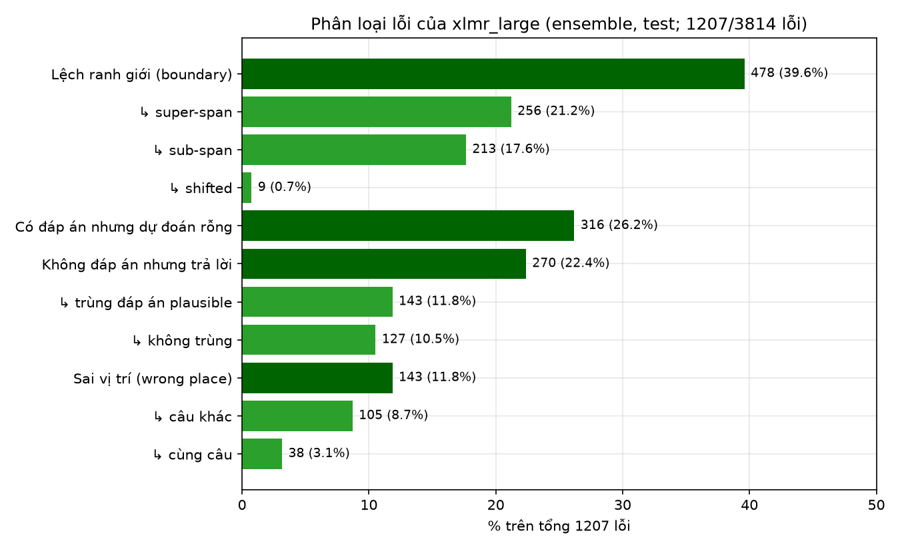

*Hình 7: tỷ trọng các nhóm lỗi của xlmr_large trên test, vẽ lại từ cùng số liệu với các cột nhóm con.*

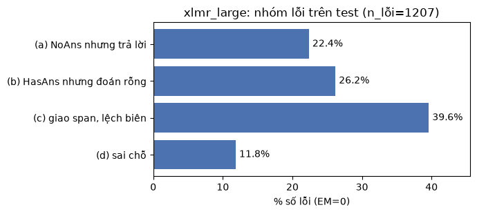

*Hình 7b: biểu đồ nhóm lỗi lưu từ notebook 06 (bốn nhóm chính, n_lỗi = 1207); cùng số liệu với Hình 7, chỉ không có cột nhóm con.*

Nguồn: `notebooks/06_error_analysis.ipynb`, cell 7.

**Quan sát.**

- Quyết định có/không có đáp án gồm (a) + (b) = 586/1.207 = **48,5%** số lỗi.
- Nhóm (c) lỗi biên (39,6%) có F1 trung bình 0,72 trên các mẫu này; EM phạt các lỗi này nặng hơn F1.
- Trong nhóm (a), 143/270 lần mô hình trả lời đúng plausible answer, tức mô hình bị "bẫy" bởi câu hỏi bị sửa nhỏ, như ví dụ mẫu `0003-0030-0001` (câu NEP/FIRA).
- Nhóm (d) sai chỗ chỉ chiếm 11,85%, trong đó 105/143 là ở câu khác; mô hình hiếm khi nhầm hoàn toàn nội dung.

**Diễn giải.** Hiểu nội dung không phải nút thắt chính; nút thắt là (1) quyết định "không có đáp án" với câu hỏi đối kháng và (2) ranh giới span (đặc biệt chọn span dài hoặc ngắn hơn tham chiếu). Điều này gợi ý hướng cải thiện (mục 20), nhưng theo nguyên tắc giao thức, phân tích này **không được dùng để chỉnh lại cấu hình đã đóng băng**.

---

## 13. Đánh giá dataset và mô hình

### 13.1. Đánh giá dataset (UIT-ViQuAD 2.0)

**Điểm mạnh.**

- Có câu NoAns đối kháng (32,39% train) kèm plausible answer ở 99,99% dòng, nên có thể tận dụng tín hiệu phụ (mục 11.3).
- Chất lượng nhãn khá tốt: lỗi offset chỉ 0,54% ở train, sửa được 100% bằng làm sạch; không dòng nào bị loại.
- Không rò rỉ context giữa train và validation (0/557).

**Hạn chế và điều cần cảnh giác.**

| Vấn đề | Dữ liệu | Hệ quả |
|---|---|---|
| Test HF không có nhãn | 7.301 dòng, `answers` rỗng | Không chấm được; dùng validation làm test, chia lại train |
| Test HF dùng chung context với train | 454/1.241 context (29,35% dòng) | Nếu có nhãn, điểm sẽ lạc quan |
| Số đáp án tham chiếu khác nhau | train 1; validation tới 3 (1.230 dòng) | EM dev thấp hơn EM test; không so EM giữa hai tập |
| Dev nhỏ về số bài | 11 title | Ước lượng dev nhiễu theo bài viết |
| Nhiễu của nhãn biên | Ranh giới đáp án mơ hồ (lỗi biên chiếm 39,6% lỗi) | F1 gần như giới hạn bởi cách chú giải biên |
| Khả năng trùng dữ liệu của mô hình có sẵn | ViQuAD 2.0 = VLSP 2021 | Mô hình tiền huấn luyện trên VLSP có thể đã thấy đề bài |
| Ranh giới giữa từ | ~1,7-2,3% đáp án bắt đầu/kết thúc giữa từ đã tách | EM của PhoBERT bị chặn ở ~98,3% |

Nguồn: `notebooks/01_data_eda.ipynb` (7.301 dòng test HF, 1.241 context, 557 context validation, 1.230 dòng nhiều tham chiếu = 32,25%, lỗi offset 0,54% ở train; cell 13 và cell có bảng split); các mục 4 và 8 của báo cáo này cho phần còn lại (dev 11 title, ranh giới giữa từ). Số 454/1.241 và 0/557 lấy từ mục 4, chưa tính lại ở đây.

### 13.2. Đánh giá mô hình

| Mô hình | Điểm mạnh quan sát được | Điểm yếu quan sát được | Chi phí (A100, mỗi lượt) |
|---|---|---|---|
| xlmr_base | Rẻ, 1 hệ token cho nhiều ngôn ngữ | F1 thấp nhất (62,40); NoAns acc 58,40; nhạy với seed (std dev 1,77) | ~8 phút |
| phobert (base-v2) | Hơn xlmr_base 6,57 F1 trên test với ít tham số hơn (135 M so với 277,5 M); nhanh nhất (~5,5 phút) | Cần tách từ (VnCoreNLP + Java); dễ phân kỳ ở lr cao (3e-5); trần EM ~98,3%; giấy phép AGPL-3.0 | ~5,5 phút |
| xlmr_large | Tốt nhất nhóm A (77,89); NoAns acc 76,74; ít nhiễu seed ở dev (0,32) | 560 M tham số; huấn luyện lâu hơn ~13,5 phút | ~13,5 phút |
| vi_mrc_base (B) | HasAns F1 cao (77,43) | NoAns acc rất thấp (35,66) | chỉ suy luận |
| vi_mrc_large (B) | F1 test cao nhất (80,48) | Dev nhiễm (89,74 so với 80,48); nhóm B | chỉ suy luận |

Nguồn: tổng hợp từ các bảng ở mục 11.4, 12.1, 12.3 và 13.3 (cùng nguồn: `notebooks/05_compare_models.ipynb` cell 7, 19, 22; `outputs/sweep/stage3/*/results.jsonl`). Thời gian là thời gian tổng (`wall_s`) trung bình giai đoạn 3: 476 s, 328 s, 833 s.

**Diễn giải.** PhoBERT-base-v2, nhỏ hơn XLM-R base một nửa tham số, vượt XLM-R base 6,57 F1; tuy nhiên đây là so sánh trong một thiết lập (một dataset, bộ siêu tham số nhỏ), không khẳng định rộng hơn. `xlmr_large` cho kết quả tốt nhất trong nhóm A nhưng cần gần gấp đôi thời gian huấn luyện so với `xlmr_base` và phải so với ensemble (3 lượt) khi đo chi phí.

### 13.3. Chi phí tính toán

**Tốc độ Colab đã đo:** T4 1,15; L4 1,94; A100 6,73 đơn vị/giờ.

**Chi phí mỗi lượt (giai đoạn 3, A100; `results.jsonl`).**

| Mô hình | Tham số (M, xấp xỉ) | Thời gian huấn luyện (s) | Thời gian tổng (s) | Bộ nhớ đỉnh (GB) | Đơn vị ước tính mỗi lượt |
|---|---|---|---|---|---|
| xlmr_base | 277,5 | 437 | 476 (trung bình) | 8,7 | 0,87-0,91 |
| phobert | 135,0 | 298 | 328 | 5,2 | 0,61-0,62 |
| xlmr_large | 559,9 | 781 | 833 | 16,2 | 1,55-1,56 |

Nguồn: `outputs/sweep/stage3/*/results.jsonl` (`train_runtime_s`, `wall_s`, `peak_mem_gb`, `est_units` của ba lượt mỗi mô hình; trung bình đã tính lại: khớp); số tham số từ `notebooks/05_compare_models.ipynb`, cell 24.

**Tổng ước tính theo giai đoạn (cộng `est_units` các lượt thành công).**

| Giai đoạn | xlmr_base | phobert | xlmr_large | Tổng |
|---|---|---|---|---|
| 1 | 2,95 | 2,15 | 7,49 | 12,59 |
| 2 | 3,52 | 2,53 | 6,14 | 12,19 |
| 3 | 2,67 | 1,84 | 4,67 | 9,18 |
| Tổng giai đoạn 1-3 | 9,14 | 6,52 | 18,30 | 33,95 |
| Release (10 lượt, mục 14b) | 2,63 | 2,45 | 4,62 | 9,71 |
| Tổng cộng | 11,77 | 8,97 | 22,92 | 43,66 |

Nguồn: tổng `est_units` (chỉ `status = ok`) trong `outputs/sweep/stage{1,2,3,release}/*/results.jsonl`, tính lại bằng script. Ô "Tổng giai đoạn 1-3" cộng từ giá trị chưa làm tròn (33,955), nên cộng các ô đã làm tròn ra 33,96; "Tổng cộng" = 33,955 + 9,709 = 43,664.

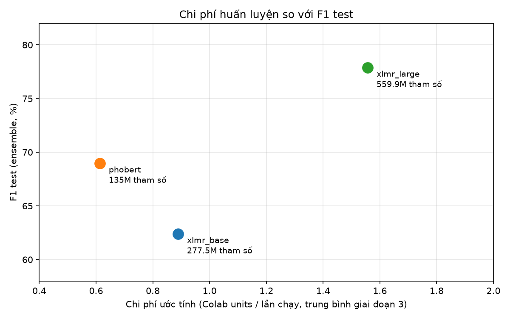

*Hình 8: chi phí huấn luyện so với F1 test.*

Nguồn: `est_units` của Hình 8 lấy từ `outputs/sweep/*/results.jsonl` (bảng chi phí của notebook 05 hiện NaN cho cột này); F1 test từ notebook 05.

**Diễn giải.** Mức chi phí thực tế lớn hơn bảng trên vì có hai lần thất bại ở giai đoạn 3 và số dư Colab đi từ 70,37 xuống khoảng 36 qua giai đoạn 2 và 3 (mục 16); sau release số dư là 24,46 (từ trao đổi, không có nguồn trong repo, chưa đối chiếu với `est_units`). Bản README cũ ghi "khoảng 45 đơn vị cho toàn bộ sweep"; con số này không tái lập được từ `results.jsonl` (33,95 cho giai đoạn 1-3, 43,66 gồm cả release; chỉ tính các lượt thành công, chưa tính lượt mất). Hình 8 chỉ gồm giai đoạn 1-3.

---

## 14. Bước 8: API `answer()` và demo CLI

Nguồn: `src/qa_api.py`, `src/demo.py`, `README.md`.

**Hiện có.**

- `src/qa_api.py`: hàm `answer(question, context, qa=..., threshold=...)` trả về `{text, score, null_diff, has_answer}`; tải mô hình lười (lazy), fp16 nếu có CUDA, ngược lại CPU fp32. Ngữ cảnh dài được xử lý bằng cửa sổ trượt (384/128); điểm null là min trên các cửa sổ; ngưỡng mặc định đọc từ `dev_threshold.json`.
- `src/demo.py`: demo terminal so sánh 5 mô hình trên cùng một câu hỏi và ngữ cảnh (`python -m src.demo`; lệnh `/models`, `/use`, `/context`, `/sample`, `/threshold`, `/help`, `/quit`), tô màu mô hình đồng thuận; mỗi lần chỉ giữ một mô hình trên GPU (vừa 6 GB, đổi lại tốn thời gian nạp). PhoBERT cần Java và `data/vncorenlp`, nếu thiếu thì được báo "không khả dụng" và các mô hình còn lại vẫn chạy.
- README đã viết lại. Bộ test dùng pytest: `python -m pytest tests -q` cho **62 passed, 0 skipped** (chạy toàn bộ ngày 2026-11-14, 262 giây, sau khi xoá `tools/` cùng 11 test của nó; trước đó 64 passed trong 243 giây; con số 49 ở bản nháp trước là 44 test cũ + 5 test của `tests/test_demo.py`).

**Trạng thái (cập nhật sau mục 14b).** Demo và `load_qa()` nay trỏ vào **model phát hành** (mục 14b), không còn dùng mô hình notebook cũ theo mặc định (mô tả hành vi theo đặc tả, chưa trích dẫn mã):

- Mặc định: **ensemble** của bản phát hành (trung bình logit các run thành viên: xlmr_base s42/43/44, phobert s42/43, xlmr_large s42/43/44, ngưỡng ensemble tune trên dev) đọc từ `outputs/release/best_models.json`. `load_qa()` mặc định là ensemble xlmr_large 3 seed (chậm khoảng 3 lần so với mô hình đơn).
- `--single` (demo; `/single` hoặc `/ensemble off` trong REPL) và `load_qa(ensemble=False)`: mô hình đơn tốt nhất (xlmr_base s43, phobert s42, xlmr_large s42; chọn theo F1 dev). `--ensemble` giữ để tương thích, không còn tác dụng.
- `--legacy` (demo) và `load_qa(legacy=True)`: dùng các mô hình notebook cũ, giữ làm bằng chứng khoa học, không bị xóa. Bảng dưới mô tả các mô hình cũ này; chúng **không phải ensemble** và không hoàn toàn là công thức cuối:

| Mô hình cũ (`--legacy`) | Nguồn file | Ghi chú |
|---|---|---|
| xlmr_large | lượt chạy đơn notebook 03 (`xlmr_large_out.tar`) | Một lượt, không phải ensemble 3 seed |
| xlmr_base | `xlmr_base_out.tar` (notebook 02) | Lượt chạy đơn lr 3e-5, 3 epoch, không phải công thức cuối |
| phobert | `phobert_base_lr2e5_out.tar` | Lượt lr 2e-5, **không phải** công thức cuối (lr 1,5e-5, 5 epoch) |
| vi_mrc_base / vi_mrc_large | tải từ HF (cần đăng nhập) | Tham chiếu nhóm B |

Nguồn: `train_summary.json` và `dev_threshold.json` trong từng file `outputs/*.tar` (đã đọc lại: xlmr_large lr 1,5e-5, 3 epoch, batch 16 x tích lũy 2; xlmr_base lr 3e-5, 3 epoch; phobert_base_lr2e5 lr 2e-5, 3 epoch; seed 42 cả bốn). Lưu ý: `phobert_base_out.tar` là lượt lr 3e-5 phân kỳ (mục 10.4), không dùng cho demo.

**Hệ quả.** Với `--legacy`, điểm số trong demo không khớp với bảng test ở mục 12 (bảng là ensemble 3 seed của công thức cuối). Chế độ mặc định (ensemble) và `--single` dùng trọng số phát hành, là kết quả huấn luyện lại công thức cuối (mục 14b); điểm của chúng là số release, không phải số gốc ở mục 12.

---

## 14b. Model phát hành (huấn luyện lại có lưu trọng số)

Nguồn chung của mục này: `notebooks/07_release_models.ipynb` (đã lưu đầu ra), `outputs/release/best_models.json`, `outputs/sweep/release/*/results.jsonl`. Số thứ tự "14b" được giữ để không phải đánh số lại các mục 15-22 và các tham chiếu chéo. **Kết quả báo cáo chính vẫn là kết quả gốc của stage 3 (mục 12); mục này là một bản tái lập riêng của các trọng số được phát hành.**

### 14b.1. Mục đích và giao thức

- Release = huấn luyện lại đúng công thức đóng băng của stage 3 (mục 11.6; seed 42/43/44) nhưng **có lưu trọng số** (fp16 safetensors, `outputs/release/`). Tổng 10 lượt: 9 lượt (3 mô hình x 3 seed) và 1 lượt chạy lại (PhoBERT seed 45).
- Cùng dữ liệu (`split_ids.json`), cùng metric `src/metrics.py`, cùng biến thể hậu xử lý `min/64/20` (không tune lại lưới). Ngưỡng no-answer tune trên dev cho từng run và từng ensemble.
- Mọi lựa chọn (thành viên ensemble, mô hình đơn tốt nhất) chỉ dựa trên dev hoặc log huấn luyện, không dựa trên test. Test được chấm đúng một lần (`RUN_TEST`, 2026-11-14).

Nguồn: `notebooks/07_release_models.ipynb`, cell 0 và cell 1 (`RUN_TEST = True`, variant `min/64/20`).

### 14b.2. Mười lượt release so với stage 3

| Run | Epoch | F1 dev release | F1 dev stage 3 | Chênh | Ngưỡng dev | Thời gian huấn luyện (s) |
|---|---|---|---|---|---|---|
| phobert__release_s42 | 5 | 68.33 | 68.31 | +0,02 | -2,00 | 293,20 |
| phobert__release_s43 | 5 | 66.28 | 66.45 | -0,17 | -1,50 | 294,57 |
| phobert__release_s44 | 5 | 62.78 | 68.41 | -5,63 | -1,00 | 295,20 |
| phobert__release_s45 | 5 | 60.86 | - (không có) | - | 0,00 | 292,61 |
| xlmr_base__release_s42 | 5 | 61.53 | 62.30 | -0,77 | 0,50 | 435,15 |
| xlmr_base__release_s43 | 5 | 63.96 | 63.06 | +0,90 | 0,50 | 431,84 |
| xlmr_base__release_s44 | 5 | 60.32 | 59.69 | +0,63 | 0,75 | 430,45 |
| xlmr_large__release_s42 | 3 | 77.76 | 76.92 | +0,84 | -1,50 | 775,17 |
| xlmr_large__release_s43 | 3 | 77.20 | 77.13 | +0,08 | -0,75 | 775,04 |
| xlmr_large__release_s44 | 3 | 77.51 | 77.55 | -0,04 | 1,75 | 774,96 |

Nguồn: `notebooks/07_release_models.ipynb`, cell 3 (bảng run release) và cell 5 (so với stage 3). Stage 3 PhoBERT s45 không tồn tại (lượt chạy lại thêm ở release).

Với `xlmr_base` và `xlmr_large`, F1 dev của release sát stage 3 (chênh nằm trong khoảng nhiễu giữa seed của mục 11.4). Ngoại lệ là PhoBERT s44 (-5,63), xem tiếp.

### 14b.3. Ổn định huấn luyện và sự cố PhoBERT

| Run | F1 dev | Epoch tốt nhất | `eval_loss` theo epoch | grad_norm lớn nhất | Tại bước |
|---|---|---|---|---|---|
| phobert__release_s42 | 68.33 | 4 | 1.353, 1.159, 1.122, 1.112, 1.123 | 22,4 | 550 |
| phobert__release_s43 | 66.28 | 3 | 1.353, 1.217, 1.144, 1.155, 2.173 | 254,8 | 4400 |
| phobert__release_s44 | 62.78 | 2 | 1.431, 1.182, 2.722, 2.648, 2.649 | 80,9 | 2850 |
| phobert__release_s45 | 60.86 | 2 | 1.354, 1.206, 2.696, 2.655, 2.679 | 115,0 | 2450 |
| xlmr_base__release_s42 | 61.53 | 4 | 1.494, 1.312, 1.269, 1.257, 1.286 | 35,8 | 150 |
| xlmr_base__release_s43 | 63.96 | 4 | 1.454, 1.308, 1.244, 1.23, 1.256 | 33,2 | 250 |
| xlmr_base__release_s44 | 60.32 | 3 | 1.495, 1.313, 1.262, 1.283, 1.287 | 41,4 | 2150 |
| xlmr_large__release_s42 | 77.76 | 2 | 1.029, 0.898, 0.918 | 207,6 | 150 |
| xlmr_large__release_s43 | 77.20 | 2 | 1.007, 0.901, 0.937 | 127,5 | 2550 |
| xlmr_large__release_s44 | 77.51 | 2 | 0.97, 0.853, 0.888 | 67,1 | 700 |

Nguồn: `notebooks/07_release_models.ipynb`, cell 5 (bảng thứ hai: `best_epoch`, `eval_loss_per_epoch`, `max_grad_norm`, `at_step`).

**Sự cố PhoBERT.** Hai trong bốn seed release (**s44, s45**) bị **phân kỳ**: `eval_loss` tăng từ khoảng 1,2 lên khoảng 2,7 ở epoch 3 và không hồi phục; checkpoint tốt nhất được khôi phục từ epoch 2 nên F1 dev chỉ 62,78 và 60,86 (so với 68,33 / 66,28 ở s42 / s43). Seed s43 có `eval_loss` tăng vọt ở epoch 5 (2,173) và grad_norm 254,8 ở bước 4400, nhưng checkpoint tốt nhất (epoch 3) được giữ (F1 66,28). Chỉ seed 42 là sạch (68,33). Ở stage 3, cùng công thức cho PhoBERT dev 68,31 / 66,45 / 68,41 và không phân kỳ. **Nguyên nhân khác biệt chưa được xác lập** (có thể do huấn luyện không tất định, thay đổi môi trường Colab, hoặc điều khác; chưa kiểm chứng). Các lượt xlmr_base và xlmr_large không có dấu hiệu tương tự trong bảng trên.

**Quyết định: ensemble phát hành của PhoBERT chỉ gồm seed 42 và 43.** Lý do: s44 và s45 phân kỳ rõ trong log (`eval_loss` ~2,7 từ epoch 3) và có dev F1 thấp (62,78 / 60,86), nên bị loại dựa trên **dev và log huấn luyện, không dựa trên test**. Hai lượt này được giữ trong `outputs/release/phobert/` làm bằng chứng. Hệ quả: ensemble PhoBERT chỉ có 2 thành viên, ít hơn 3 seed của stage 3, nên so sánh với ensemble gốc không hoàn toàn trực tiếp.

Nguồn: `notebooks/07_release_models.ipynb`, cell 6 (nhận xét và quyết định).

### 14b.4. Ensemble và mô hình đơn

Ensemble = trung bình logit của các run thành viên, biến thể `min/64/20`, ngưỡng ensemble tune trên dev. Mô hình đơn tốt nhất = run có F1 dev cao nhất trong các thành viên ensemble của mô hình đó.

| Mô hình | F1 dev từng thành viên | Trung bình thành viên | F1 dev ensemble | Lợi ích so với trung bình | Ngưỡng ensemble |
|---|---|---|---|---|---|
| xlmr_base | s42 61.53, s43 63.99, s44 60.36 | 61.96 | 63.33 | +1,37 | 1,00 |
| phobert | s42 68.33, s43 66.28 | 67.31 | 68.19 | +0,88 | -1,50 |
| xlmr_large | s42 77.75, s43 77.19, s44 77.50 | 77.48 | 78.59 | +1,11 | -0,25 |

Nguồn: `notebooks/07_release_models.ipynb`, cell 10 (F1 dev chấm lại từ logit nên lệch tối đa 0,04 so với `f1_tuned` ở mục 14b.2, ví dụ xlmr_base s43 63.99 so với 63.96).

| Mô hình | Mô hình đơn tốt nhất | F1 dev | Ngưỡng dev của run |
|---|---|---|---|
| xlmr_base | `xlmr_base__release_s43` | 63.96 | 0,5 |
| phobert | `phobert__release_s42` | 68.33 | -2,0 |
| xlmr_large | `xlmr_large__release_s42` | 77.76 | -1,5 |

Nguồn: `outputs/release/best_models.json` (cũng ở cell 13 của notebook 07).

### 14b.5. Kết quả dev, test và so với bản gốc

**Dev, ensemble release (CI bootstrap 95%, 2.000 lần).**

| Mô hình | EM | F1 | HasAns F1 | NoAns acc |
|---|---|---|---|---|
| xlmr_base | 49.18 [47.32, 51.00] | 63.33 [61.75, 64.92] | 68.76 [67.04, 70.45] | 52.20 [49.06, 55.56] |
| phobert | 52.23 [50.34, 54.12] | 68.19 [66.64, 69.70] | 71.84 [70.15, 73.48] | 60.69 [57.75, 63.73] |
| xlmr_large | 63.70 [61.88, 65.49] | 78.59 [77.21, 79.90] | 78.33 [76.87, 79.79] | 79.14 [76.52, 81.66] |

Nguồn: `notebooks/07_release_models.ipynb`, cell 11. Điểm dev hơi lạc quan vì ngưỡng tune trên chính dev.

**Test (3.814 mẫu, chấm một lần; CI bootstrap 95%).** Ensemble dùng ngưỡng dev của ensemble, từng run dùng ngưỡng dev của run; "đơn tốt nhất" trùng với dòng run tương ứng.

| Mô hình / run | EM | F1 | HasAns F1 | NoAns acc |
|---|---|---|---|---|
| xlmr_base ensemble (s42, s43, s44) | 54.46 [52.81, 56.06] | 63.59 [62.11, 65.00] | 67.40 [65.74, 68.99] | 54.87 [52.02, 57.54] |
| xlmr_base__release_s43 (đơn tốt nhất) | 54.33 [52.73, 55.98] | 63.14 [61.64, 64.66] | 63.48 [61.83, 65.09] | 62.36 [59.52, 65.12] |
| xlmr_base__release_s42 | 52.99 [51.36, 54.64] | 61.28 [59.72, 62.81] | 61.78 [60.10, 63.48] | 60.12 [57.28, 62.96] |
| xlmr_base__release_s44 | 51.05 [49.45, 52.60] | 61.10 [59.54, 62.51] | 66.80 [65.25, 68.33] | 48.06 [45.13, 50.90] |
| phobert ensemble (s42, s43) | 59.07 [57.55, 60.62] | 68.62 [67.22, 70.01] | 71.58 [70.04, 73.10] | 61.84 [59.00, 64.51] |
| phobert__release_s42 (đơn tốt nhất) | 58.18 [56.61, 59.81] | 68.10 [66.67, 69.52] | 69.00 [67.44, 70.57] | 66.06 [63.39, 68.73] |
| phobert__release_s43 | 57.29 [55.74, 58.84] | 66.82 [65.37, 68.29] | 69.56 [68.00, 71.11] | 60.55 [57.80, 63.39] |
| xlmr_large ensemble (s42, s43, s44) | 68.35 [66.91, 69.93] | 77.68 [76.47, 78.99] | 77.15 [75.78, 78.56] | 78.90 [76.49, 81.31] |
| xlmr_large__release_s42 (đơn tốt nhất) | 66.60 [65.18, 68.14] | 76.38 [75.14, 77.70] | 75.92 [74.52, 77.31] | 77.43 [75.11, 79.84] |
| xlmr_large__release_s43 | 66.73 [65.23, 68.30] | 76.78 [75.53, 78.07] | 76.27 [74.87, 77.70] | 77.95 [75.54, 80.36] |
| xlmr_large__release_s44 | 67.59 [66.12, 69.09] | 77.59 [76.28, 78.84] | 78.68 [77.27, 80.07] | 75.11 [72.61, 77.52] |

Nguồn: `notebooks/07_release_models.ipynb`, cell 17 (bảng test với CI). PhoBERT s44, s45 không được chấm trên test (đã bị loại trước khi chấm).

**So với ensemble gốc của stage 3 (F1 test).**

| Mô hình | F1 gốc (nb 05) | F1 gốc tính lại | F1 release | Chênh (release - gốc) | Số thành viên release | CI 95% của chênh | p |
|---|---|---|---|---|---|---|---|
| xlmr_base | 62.40 | 62.40 | 63.59 | +1,19 | 3 | [0,44, 1,89] | 0,000 |
| phobert | 68.97 | 68.97 | 68.62 | -0,35 | 2 | [-0,88, 0,17] | 0,901 |
| xlmr_large | 77.89 | 77.89 | 77.68 | -0,21 | 3 | [-0,86, 0,46] | 0,741 |

Nguồn: `notebooks/07_release_models.ipynb`, cell 19 (số gốc lấy từ `notebooks/05_compare_models.ipynb`, cell 19; kiểm định ghép cặp bootstrap, p = tỉ lệ resample có hiệu <= 0).

**Diễn giải.** Chỉ `xlmr_base` khác bản gốc có ý nghĩa (+1,19, CI không chứa 0); với `phobert` và `xlmr_large`, CI chứa 0 nên không phân biệt được với bản gốc. Chênh +1,19 ở `xlmr_base` cùng bậc với nhiễu giữa seed (mục 11.4), nên không nên đọc là "release tốt hơn"; CI chỉ phản ánh phương sai do mẫu ví dụ, không phải phương sai huấn luyện.

### 14b.6. Kích thước và chi phí

| Mô hình | Tham số (M) | Số run đã huấn luyện | Dung lượng mỗi run, fp16 (MiB) | Dung lượng ensemble phát hành (MiB) | Tổng `est_units` | Tổng thời gian huấn luyện (s) |
|---|---|---|---|---|---|---|
| xlmr_base | 277,5 | 3 | 529,2 | 1587,7 | 2,6 | 1297,4 |
| phobert | 135,0 | 4 | 256,4 | 512,8 | 2,5 | 1175,6 |
| xlmr_large | 559,9 | 3 | 1066,0 | 3197,9 | 4,6 | 2325,2 |

Nguồn: `notebooks/07_release_models.ipynb`, cell 21. Dung lượng ensemble của PhoBERT tính cho 2 thành viên (s42, s43); thư mục `outputs/release/phobert/` còn chứa s44 và s45 làm bằng chứng.

- Tổng `est_units` của 10 lượt release: **9,71** (xlmr_base 2,63; phobert 2,45; xlmr_large 4,62), cộng `est_units` các lượt `status = ok` trong `outputs/sweep/release/*/results.jsonl`.
- Tổng cả dự án theo `est_units`: 33,95 (giai đoạn 1-3) + 9,71 (release) = **43,66** (bảng ở mục 13.3).
- Số dư Colab của cả dự án đi từ 70,37 xuống 24,46 (gồm cả các phiên Colab, kể cả lượt mất của giai đoạn 3). Hai số dư này **không có nguồn trong repo** (từ trao đổi) và chưa được đối chiếu với `est_units`.
- fp16: kiểm tra trước đó cho thấy argmax khớp 99,0-100% với logit đã lưu trên 100-300 ví dụ dev (PhoBERT chưa kiểm tra).

### 14b.7. Cách dùng

- `python -m src.demo`: mặc định dùng ensemble của bản phát hành (trung bình logit các run thành viên, ngưỡng ensemble tune trên dev); `--single`: mô hình đơn tốt nhất; `--legacy`: mô hình notebook cũ. Chi tiết ở mục 14.
- `from src.qa_api import load_qa, answer`: `load_qa()` mặc định là ensemble xlmr_large 3 seed, `load_qa(ensemble=False)` là `xlmr_large__release_s42`; `load_qa(legacy=True)` là mô hình cũ.
- Trọng số, `best_models.json` và logit nằm trong `outputs/release/` và `outputs/sweep/release/`. Bản lưu trữ và trọng số đã được tải lên Hugging Face (đã công khai ngày 2026-11-14; xem mục 14b.9). Để demo dùng bản tải về, đặt vào `outputs/release/` như hướng dẫn trong `README.md` (chưa kiểm thử).
- Giấy phép: trọng số PhoBERT đã fine-tune theo AGPL-3.0 (như mô hình gốc); XLM-R: xem thẻ model gốc (chưa kiểm chứng trong repo).

### 14b.8. Hạn chế

- Trọng số lưu ở fp16 nên điểm có thể lệch nhẹ so với `summary.json`; PhoBERT chưa được kiểm tra khớp argmax.
- Huấn luyện không hoàn toàn tất định: cùng công thức và seed vẫn có thể cho kết quả khác stage 3 (mục 11.4, 14b.3).
- **PhoBERT dễ vỡ ổn định:** hai trong bốn seed release phân kỳ; nguyên nhân chưa được xác lập.
- Ensemble PhoBERT chỉ có 2 thành viên (s42, s43), việc loại s44/s45 là quyết định dựa trên dev và log; không so sánh trực tiếp hoàn toàn được với 3 seed của stage 3.
- Ngưỡng và biến thể tune trên dev nên điểm dev lạc quan; CI bootstrap không phản ánh phương sai huấn luyện.
- Số của mục này là bản tái lập; số báo cáo chính vẫn là kết quả gốc ở mục 12.
- Việc tải trọng số từ hub về rồi nạp lại **chưa được kiểm thử**; các đoạn mã trong thẻ model chưa được chạy (mục 14b.9).
- Cả bốn repo Hugging Face đã công khai ngày 2026-11-14; chưa kiểm tra truy cập khi chưa đăng nhập, và chưa thử nạp model từ hub. Lịch sử (history) của repo dataset vẫn chứa ba tệp tar đã gỡ (mục 14b.9).

Nguồn: `notebooks/07_release_models.ipynb`, cell 22 (mục Hạn chế) và cell 6; mục 14b.9 cho hai dòng cuối.

### 14b.9. Lưu trữ và phát hành lên Hugging Face

| Repo (tài khoản `DinhIchMinhHoang`) | Loại | Số tệp | Nội dung | Trạng thái |
|---|---|---|---|---|
| [`viquad2-xlmr-base`](https://huggingface.co/DinhIchMinhHoang/viquad2-xlmr-base) | model | 15 | release xlmr_base s42-s44, `best_models.json`, thẻ | công khai (2026-11-14) |
| [`viquad2-phobert`](https://huggingface.co/DinhIchMinhHoang/viquad2-phobert) | model | 19 | release phobert 4 seed (s44, s45 phân kỳ, có ghi nhãn), `best_models.json`, thẻ | công khai (2026-11-14) |
| [`viquad2-xlmr-large`](https://huggingface.co/DinhIchMinhHoang/viquad2-xlmr-large) | model | 15 | release xlmr_large s42-s44, `best_models.json`, thẻ | công khai (2026-11-14) |
| [`viquad2-extractive-qa-archive`](https://huggingface.co/datasets/DinhIchMinhHoang/viquad2-extractive-qa-archive) | dataset | 322 | `data/processed`; `outputs/sweep` (logit, tóm tắt); `outputs/xlmr_base`, `xlmr_large`, `phobert_base` (mô hình giải nén từ notebook); `outputs/phobert_base_out.tar`; hình; tar `release_small`; các `MANIFEST.json` | công khai (2026-11-14) |

---

## 15. Kết luận

1. **Mô hình tốt nhất nhóm A là `xlmr_large`** (test F1 77.89 [76.68, 79.15], EM 68.35, NoAns acc 76.74, ensemble 3 seed). Thứ tự xlmr_large > phobert > xlmr_base có ý nghĩa thống kê (hiệu F1 ghép cặp -15.49, -8.92, -6.57, CI không chứa 0).
2. **PhoBERT-base-v2 vượt XLM-R base 6.57 F1** với ít tham số hơn một nửa, nhưng nhạy với lr, cần tách từ và có trần EM ~98,3%.
3. **Tham chiếu nhóm B không so sánh công bằng.** `vi_mrc_large` có F1 test cao nhất (80.48), chỉ hơn `xlmr_large` 2,59 F1 (EM không khác biệt đáng kể: -0,55, CI chứa 0), và dev bị nhiễm (89.74 so với 80.48).
4. **LLRD, EMA không giúp; plausible loss λ = 0,3 chưa được chứng minh.** Hiệu quả +0,8 ở một seed biến mất khi lặp 3 seed; cùng cấu hình `xlmr_large` và seed 42 chạy hai lần cho 78,16 (giai đoạn 2) và 76,92 (giai đoạn 3), nên "+0,8" là nhiễu không tất định, chưa giải thích được nguyên nhân.
5. **Hậu xử lý mặc định đủ tốt.** Không biến thể nào trong lưới 18 hơn mặc định quá 0,3 F1.
6. **Điểm yếu chính là quyết định "có/không có đáp án" (48,5% lỗi) và ranh giới span (39,6% lỗi)**, không phải hiểu nội dung.
7. **Kết quả đáng tin ở mức nhóm A; chưa đủ để kết luận mạnh hơn** vì số seed ít, lưới nhỏ và dev nhỏ (11 title).
8. **Model phát hành tái lập được kết quả gốc ở mức không phân biệt được, trừ xlmr_base.** Test ensemble release F1 63.59 / 68.62 / 77.68 so với gốc 62.40 / 68.97 / 77.89; chênh +1,19 [0,44, 1,89], -0,35 [-0,88, 0,17], -0,21 [-0,86, 0,46] (chỉ xlmr_base khác có ý nghĩa). Số báo cáo chính vẫn là bản gốc (mục 14b).
9. **Công thức PhoBERT có vẻ kém ổn định**: ở release 2 trong 4 seed phân kỳ ở epoch 3 trong khi stage 3 (cùng công thức) không phân kỳ; **chưa xác định nguyên nhân** (mục 14b.3). Vì vậy ensemble phát hành của PhoBERT chỉ gồm seed 42 và 43.

---

## 16. Hệ quả và hạn chế

**Các hạn chế được ghi nhận.**

- **Nhiễu một seed ở giai đoạn 1-2.** Độ lệch chuẩn giữa seed ở giai đoạn 3: dev F1 1,77 (xlmr_base), 1,10 (phobert), 0,32 (xlmr_large); trên test 1,25 / 0,78 / 1,25. Mọi chênh lệch nhỏ hơn khoảng 1-2 điểm giữa các cấu hình giai đoạn 1-2 là không phân biệt được với nhiễu.
- **λ = 0,3 không xác nhận qua seed.** Trung bình 3 seed xlmr_base 61,68 (cơ sở 61,53); xlmr_large 77,20 (cơ sở 77,39 ở một seed). Cùng cấu hình/seed ở xlmr_large cho hai kết quả khác nhau (78,16 và 76,92); nguyên nhân chưa điều tra.
- **LLRD chỉ thử hệ số 0,9**, có thể quá mạnh với mô hình 24 lớp.
- **Lưới giai đoạn 1 nhỏ** (4 cấu hình mỗi mô hình). "Ngân sách bằng nhau" là công bằng về ngân sách tìm kiếm, không phải tối ưu hoá đầy đủ; một mô hình có thể còn cấu hình tốt hơn chưa thử.
- **Ensemble 3 seed của cùng công thức.** Được phép trong từng mô hình, nhưng mọi con số của nhóm A trong bảng test là ensemble; số của một lượt đơn thấp hơn khoảng 0,45-1,6 F1 (mục 12.1).
- **Nhóm B không so sánh được** (dữ liệu ngoài, dev bị nhiễm, đường suy luận khác tác giả).
- **EM test cao hơn dev ~5 điểm**: nguyên nhân (nhiều tham chiếu) chưa kiểm chứng.
- **Dev nhỏ về số bài** (11 title) nên chọn cấu hình trên dev nhiễu theo bài viết.
- **Giấy phép**: PhoBERT dùng AGPL-3.0; cần xem lại điều khoản khi phân phối hoặc nhúng vào hệ thống.
- **Demo và `load_qa()` nay dùng model phát hành** (mục 14b), là bản huấn luyện lại, không phải đúng các lượt stage 3 đã báo cáo; chế độ `--legacy` vẫn dùng mô hình notebook cũ (mục 14).
- **Model phát hành:** PhoBERT dễ vỡ ổn định (2/4 seed phân kỳ, chưa rõ nguyên nhân); ensemble PhoBERT chỉ 2 thành viên; trọng số fp16 (PhoBERT chưa kiểm khớp argmax); số release là bản tái lập, chỉ `xlmr_base` khác bản gốc có ý nghĩa (mục 14b.8).
- **Giấy phép trọng số phát hành:** trọng số PhoBERT đã fine-tune theo AGPL-3.0; XLM-R: xem thẻ model gốc.
- **Không tái lập được bước đóng gói/tải lên bằng script:** các script `tools/` đã xoá ngày 2026-11-14 và chưa từng commit; chỉ còn artefact và `MANIFEST.json` (cách kiểm tra thủ công ở `docs/ARCHIVE.md`).
- **Lưu trữ Hugging Face:** việc nạp model từ hub chưa được kiểm thử; lịch sử hub còn giữ 3 tar đã gỡ; cả bốn repo đã công khai (2026-11-14), chưa kiểm tra truy cập khi chưa đăng nhập; thẻ model còn `TODO` ở trích dẫn (mục 14b.9).
- **Chưa có phân tích lỗi cho `phobert` và `xlmr_base`**, chỉ cho `xlmr_large`.
- **Không có dữ liệu ngoài** cho nhóm A; kết quả có thể thấp hơn mức đạt được nếu được phép dùng thêm dữ liệu.

**Hệ quả thực tế.** Nếu cần mô hình triển khai: dùng `xlmr_large` (ensemble nếu chịu được chi phí 3 lần suy luận); nếu cần nhẹ hơn: PhoBERT, đánh đổi bằng phụ thuộc Java + VnCoreNLP và giấy phép AGPL-3.0.

---

## 17. Thành quả

- Giao thức dữ liệu và đánh giá sạch (chia theo title, test chấm một lần, không rò rỉ context giữa train và test), có kiểm tra tự động.
- Bộ mã nguồn tái lập được: làm sạch, chia, tách từ + căn chỉnh offset, cửa sổ trượt, hậu xử lý, metric, sweep có thể tiếp tục, bộ công cụ chấm từ logit (CPU), zero-shot.
- Kết quả có khoảng tin cậy cho ba mô hình nhóm A và hai tham chiếu nhóm B.
- Phát hiện về nhiễu giữa seed và về các kỹ thuật không giúp (LLRD, EMA, λ), giúp tránh kết luận từ một seed.
- Phân tích lỗi cho `xlmr_large`: 48,5% lỗi là quyết định có/không có đáp án.
- Tokenizer fast cho PhoBERT (kèm kiểm chứng với tokenizer chậm) và pipeline tách từ + ánh xạ offset ngược.
- API `answer()` và demo terminal so sánh 5 mô hình; README viết lại; bộ test pytest (62 passed, 0 skipped khi chạy toàn bộ `python -m pytest tests -q` ngày 2026-11-14, 262 giây; 11 test của các công cụ đóng gói đã xoá được loại khỏi bộ test).
- Model phát hành: 10 lượt huấn luyện lại có lưu trọng số fp16, mô hình đơn tốt nhất và ensemble cho cả ba mô hình, chấm test một lần với CI và so sánh ghép cặp với bản gốc (mục 14b).

---

## 18. Công việc tiếp theo

Các đề xuất dưới đây là **hướng cần thí nghiệm**, không phải kết luận đã kiểm chứng.

1. **Kiểm tra nguyên nhân EM test > EM dev**: chấm test chỉ với tham chiếu đầu tiên.
2. **Quét LLRD với hệ số lớn hơn** (ví dụ 0,95, 0,98) và thử tăng số seed để xác định lại tác dụng của λ.
3. **Nhắm vào hai nguồn lỗi chính**: hiệu chỉnh quyết định có/không có đáp án (ngưỡng theo loại câu hỏi, hiệu chuẩn xác suất) và ranh giới span (ví dụ huấn luyện loss biên); phân tích lỗi tương tự cho `phobert` và `xlmr_base`.
4. **Điều tra vì sao xlmr_large cùng cấu hình/seed cho kết quả khác nhau** (78,16 so với 76,92).
5. ~~**Đóng gói công thức cuối** thành artifact để demo và `answer()` dùng~~ Đã thực hiện bằng model phát hành (mục 14b). Còn lại: điều tra nguyên nhân PhoBERT phân kỳ ở release (chạy lại có kiểm soát tất định/môi trường) (việc tải `outputs/`, `data/` lên Hugging Face đã làm, mục 14b.9).
9. **Hugging Face (đã công khai):** điền `TODO` trích dẫn trong `docs/hf_cards/` và trên thẻ hub (hub vẫn còn dòng `TODO`); thử tải model từ hub về `outputs/release/` và chạy các đoạn mã trong thẻ; commit và cập nhật con trỏ submodule của repo cha.
6. **Kiểm tra nhiễm dữ liệu của `vi_mrc_large`** trực tiếp (trùng mẫu giữa ViQuAD 2.0 và VLSP-MRC-2021), và đối chiếu số liệu với model card của tác giả.
7. **Mở rộng lưới giai đoạn 1** nếu muốn kết luận "so sánh công bằng" ở mức tối ưu hoá, và dùng dev lớn hơn (nhiều title) hoặc k-fold theo title.
8. **Thử nghiệm kiểm soát về tách từ** (PhoBERT với và không tách từ) để định lượng tác dụng của tách từ.

---

## 19. Phụ lục: nguồn số liệu, điểm không khớp và những gì chưa kiểm chứng

### 19.1. Nguồn

| Nội dung | Nguồn |
|---|---|
| EDA, làm sạch, chia tập | `notebooks/01_data_eda.ipynb`, `src/data_clean.py`, `src/data_split.py` |
| Lượt chạy đơn | `notebooks/02_finetune_xlmr.ipynb`, `03_finetune_xlmr_large.ipynb`, `04_finetune_phobert.ipynb` |
| So sánh, test, bootstrap | `notebooks/05_compare_models.ipynb`, `src/evalkit.py` |
| Phân tích lỗi | `notebooks/06_error_analysis.ipynb` |
| Giai đoạn 1-3 | `configs/sweep_stage1.json`, `sweep_stage2.json`, `sweep_stage3.json`; `outputs/sweep/stage*/*/results.jsonl` |
| Zero-shot nhóm B | `outputs/sweep/zero_shot/*/*/summary.json` |
| Tokenizer | chạy trực tiếp `xlm-roberta-base` và `vinai/phobert-base-v2` qua `src/phobert.py` bằng Python của `.venv` |
| Số liệu phân kỳ PhoBERT lr 3e-5 | `outputs/phobert_base_out.tar` (`train_summary.json`, `dev_threshold.json`); chú thích ở `notebooks/04_finetune_phobert.ipynb`, cell 1 |
| Tốc độ A100 6,73 đơn vị/giờ | hằng `RATE_UNITS_PER_HR = 6.73` ở cell 15 của notebook 02, 03, 04 |
| Model phát hành (mục 14b) | `notebooks/07_release_models.ipynb`, `configs/sweep_release.json`, `configs/sweep_release_rerun.json`, `outputs/release/best_models.json`, `outputs/sweep/release/*/results.jsonl` |
| Lưu trữ Hugging Face (mục 14b.9) | `docs/ARCHIVE.md` (các script đóng gói/tải lên đã xoá ngày 2026-11-14, chưa từng commit); số tệp và trạng thái công khai do chủ dự án kiểm tra bằng `hf` CLI (2026-11-14), không có log trong repo |

### 19.2. Điểm không khớp giữa các nguồn (đã ghi nhận khi viết)

- Báo cáo dùng số lấy từ `results.jsonl`. Một số con số làm tròn hai chữ số khác ghi chú trong phiên: ví dụ phobert lr 1,5e-5 e5 là 68.32 (ghi chú: 68.31), xlmr_large lr 1,5e-5 e3 là 77.39 (ghi chú: 77.38). Chênh do làm tròn.
- Notebook 03 (lượt chạy đơn) ghi dev F1 78.30 cho xlmr_large lr 1,5e-5, 3 epoch, trong khi cùng cấu hình ở giai đoạn 1 cho 77.39 (chênh 0,91); xlmr_base và phobert chênh dưới 0,35 (59.90 so với 60.22; 67.52 so với 67.64). **Chưa giải thích được.** Đã kiểm: `train_summary.json` trong `outputs/xlmr_large_out.tar` ghi cùng cấu hình với giai đoạn 1 (lr 1,5e-5, 3 epoch, seed 42, batch 16 x tích lũy 2); `src/train_qa.py` đặt `seed`, `data_seed` (mặc định bằng seed) và `set_seed`, không bật chế độ tất định (không có `use_deterministic_algorithms`), dùng bf16 nếu GPU hỗ trợ. Các điểm này có thể gây nhiễu số học giữa hai lượt nhưng chưa được kiểm chứng là nguyên nhân (chưa chạy lại để đo).

- Độ lệch chuẩn giữa seed: ghi chú phiên là 0,3-1,4; số thực của dev là 0,32 / 1,10 / 1,77 (n-1) và test là 0,78 / 1,25 / 1,25.

### 19.3. Chưa kiểm chứng

- Nguyên nhân EM test cao hơn EM dev (giả thuyết: nhiều tham chiếu).
- Nguyên nhân kết quả khác nhau giữa hai lượt xlmr_large cùng cấu hình và seed (78,16 so với 76,92).
- Nguyên nhân lệch số liệu `vi_mrc_*` với model card; thang điểm null khác (ngưỡng -9,5 / -9,25).
- Dev của `vi_mrc_large` bị nhiễm: suy luận từ chênh dev/test, chưa kiểm tra trực tiếp trùng mẫu.
- Tác dụng của tách từ đối với độ chính xác của PhoBERT (không có thí nghiệm kiểm soát).
- LLRD ở các hệ số khác 0,9; tác dụng thật của λ.
- Chênh giữa `est_units` giai đoạn 2 (12,19) và mức trừ thực tế (~9).
- Số dư Colab 70,37 và 24,46 (cả dự án) không có nguồn trong repo và chưa đối chiếu với tổng `est_units` 43,66.
- Nguyên nhân PhoBERT phân kỳ ở release (seed 44, 45) trong khi stage 3 không phân kỳ.
- Khớp argmax fp16 của PhoBERT (chỉ kiểm xlmr; con số 99,0-100% lấy từ ghi chú trong notebook 07, cell 22, không có file kiểm trong repo).
- Nguyên nhân phân kỳ của lượt PhoBERT lr 3e-5 (log còn trong `outputs/phobert_base_out.tar`, nhưng chỉ có một lượt, một seed).
- Tỷ lệ token rơi vào nhóm id ≥ 64.001 trên toàn tập dữ liệu.

## 20. Phụ lục: Đối chiếu số liệu

### 20.1. Các chỗ đã sửa trong lần rà soát này

| Số liệu | Trong bản nháp | Đúng theo nguồn | Nguồn |
|---|---|---|---|
| Số test | 44 test pytest (phiên làm việc); README: tests dạng script, không dùng pytest | 49 passed bằng pytest (44 + 5 của `tests/test_demo.py`) | `python -m pytest tests -q`; `README.md` đã sửa |
| Số test (sau công cụ lưu trữ) | 49 passed | 64 passed (toàn bộ, 243 giây); README và mục 14, 14b.9, 19 đã cập nhật | `python -m pytest tests -q` |
| Số test (sau khi xoá `tools/`, 2026-11-14) | 64 passed | 62 passed, 0 skipped (toàn bộ, 262 giây); 11 test của công cụ đã xoá (`tests/test_release_tools.py` 7, `tests/test_archive_tools.py` 4) bị loại; README và mục 14, 14b.9, 19 đã cập nhật | `python -m pytest tests -q` |
| Chi phí giai đoạn 2 | khoảng 9 đơn vị | 12,19 (xlmr_base 3,52; phobert 2,53; xlmr_large 6,14) | tổng `est_units` của `outputs/sweep/stage2/*/results.jsonl` |
| Chi phí toàn sweep | README: ~45 đơn vị | 33,95 cho các lượt thành công (12,59 + 12,19 + 9,18); ~45 không tái lập được | tổng `est_units` của `outputs/sweep/stage{1,2,3}/*/results.jsonl` |
| Tác dụng của λ = 0,3 ở xlmr_large | +0,8 F1 (78,16 so với 77,39) | nhiễu: cùng cấu hình, seed 42 cho 78,16 (giai đoạn 2) và 76,92 (giai đoạn 3), chênh 1,24 | `stage2/xlmr_large/results.jsonl` (`pl0.3`), `stage3/xlmr_large/results.jsonl` (`final_s42`) |
| xlmr_large notebook 03 so với giai đoạn 1 | 78,30 so với 77,39 (không giải thích) | chưa giải thích được; đã kiểm cấu hình trong `outputs/xlmr_large_out.tar` và seed/tất định trong `src/train_qa.py` | `notebooks/03_finetune_xlmr_large.ipynb`; `stage1/xlmr_large/results.jsonl` |
| phobert lr 1,5e-5, 5 epoch, seed 42 | 68,31 (ghi chú phiên) | 68,32 ở giai đoạn 1 và 68,31 ở `final_s42` giai đoạn 3 (làm tròn/nhiễu 0,01) | `stage1/phobert/results.jsonl`, `stage3/phobert/results.jsonl` |
| xlmr_large lr 1,5e-5, 3 epoch (cơ sở) | 77,38 (ghi chú phiên) | 77,39 (77,3913...) | `stage1/xlmr_large/results.jsonl` |
| Bước tăng grad_norm của PhoBERT lr 3e-5 | 532 ở bước ~1850, "không còn nguồn" | 532,45 ở bước 1900 (52,2 ở bước 1850); log còn trong tar | `outputs/phobert_base_out.tar` (`train_summary.json`) |
| F1 từng seed xlmr_large (notebook 05) | 76.9 / 77.12 / 77.59, std 0,35 | 76.92 / 77.13 / 77.55, std 0,32 trong `results.jsonl`; notebook 05 cell 11 tune lại ngưỡng nên hơi khác (trung bình vẫn 77,20) | `stage3/xlmr_large/results.jsonl`; notebook 05 cell 7 và 11 |
| Độ lệch chuẩn giữa seed | 0,3-1,4 (ghi chú phiên) | dev 0,32 / 1,10 / 1,77; test 0,78 / 1,25 / 1,25 | notebook 05 cell 7, cell 17 |
| Ô Tổng của bảng chi phí | cộng ô làm tròn = 33,96 | 33,95 (33,955 từ giá trị chưa làm tròn) | tổng `est_units` ở trên |
| Số dư Colab giai đoạn 2 "~9" | dùng như mức trừ thực tế | không có nguồn; chỉ còn ước tính 12,19 | mục 16 |
| Chi phí toàn dự án (sau release) | 33,95 (giai đoạn 1-3) | 43,66 = 33,955 + 9,709 (release, 10 lượt: 2,63 + 2,45 + 4,62); README đã sửa dòng "~34 đơn vị" | tổng `est_units` của `outputs/sweep/stage{1,2,3,release}/*/results.jsonl` |
| Mô hình demo / `load_qa()` | mô hình notebook cũ (README, mục 14) | mặc định là ensemble phát hành (`outputs/release/best_models.json`); `--single` / `ensemble=False` = mô hình đơn; `--legacy` / `legacy=True` cho mô hình cũ | mục 14, 14b; README đã sửa |
| F1 dev từng run release | 63.96 (`f1_tuned`) ở bảng 14b.2 | 63.99 khi chấm lại từ logit ở bảng 14b.4 (tương tự 60.32 so với 60.36, 77.76 so với 77.75, 77.20 so với 77.19, 77.51 so với 77.50) | notebook 07, cell 3 và cell 10; không phải lỗi, hai cách chấm khác nhau |

Nguồn: cột cuối của từng dòng; tính lại bằng script từ `outputs/sweep/stage*/*/results.jsonl`, notebook 05/06 và `outputs/*.tar`.

Ghi chú (2026-11-13): notebook 06 được chạy lại một lần để lưu biểu đồ (số liệu không đổi: n = 3814, EM 68,35, F1 77,89, NoAns 76,74, số lỗi từng nhóm giống hệt); notebook 05 được thêm 5 cell biểu đồ tĩnh (cell 26-36) mà không chạy lại.

### 20.2. Còn thiếu nguồn trong repo (từ trao đổi)

- **Đã có nguồn:** số liệu phân kỳ PhoBERT lr 3e-5 (grad_norm 532,45 ở bước 1900, loss 1,16 lên 2,23, F1 59,50) trong `outputs/phobert_base_out.tar` và chú thích ở `notebooks/04_finetune_phobert.ipynb` cell 1; tốc độ A100 6,73 đơn vị/giờ là hằng `RATE_UNITS_PER_HR` ở cell 15 của notebook 02-04.

